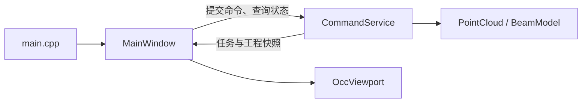

# ReverseModeling 开发指南

本项目是基于 C++20、Qt Widgets 和 OCCT 的点云辅助逆向建模桌面应用。主要流程是：导入 PCD 点云，计算梁框架与尺寸初值，编辑 H 型钢及肋板参数，生成模型，再进行偏差计算和 STEP 导出。

工程包含两个可执行程序：

| 程序 | 职责 | CMake 入口 |
|---|---|---|
| `ReverseModeler` | 桌面交互、点云与模型显示、建模操作 | [主程序 CMakeLists.txt](CMakeLists.txt) |
| `ReverseServiceTests` | 使用 Google Test 检查几何与命令服务 | [测试程序 CMakeLists.txt](../tests/CMakeLists.txt) |

开发时打开仓库根目录的 [CMakeLists.txt](../CMakeLists.txt)。两个程序直接编译同一份业务源码，工程内部不生成独立业务库。

## 目录与代码入口

```text
PointCloudReverseModeling/
├── CMakeLists.txt               # 总入口，加载两个子项目
├── CMakePresets.json            # 全仓库唯一的构建预设
├── cmake/
│   ├── common.cmake             # C++ 标准、编译选项与输出目录
│   └── Dependencies.cmake       # 全部第三方库查找与公共链接库
├── ReverseModeling/
│   ├── CMakeLists.txt           # 主程序文件清单、头文件搜索目录和链接库
│   ├── ReverseModeling.cmake    # 汇总 core、geometry、commands 的公共文件
│   ├── main.cpp                # QApplication 与 MainWindow 入口
│   ├── core/                   # 点云、参数、网格和结果的数据类型
│   ├── geometry/               # 点云读取、PCA、建模、STEP 与偏差算法
│   ├── commands/               # 异步命令、工程状态、参考参数与 JSON
│   ├── workbench/              # Qt 窗口与 OCCT 视口
│   └── examples/               # 参数格式示例
└── tests/
    ├── CMakeLists.txt           # 测试程序文件清单、头文件搜索目录和链接库
    ├── tests.cmake             # 测试文件清单
    └── service_tests.cpp        # Google Test 用例
```

建议按以下顺序阅读：

| 文件 | 重点 |
|---|---|
| [main.cpp](main.cpp) | 应用启动与主窗口创建 |
| [MainWindow.cpp](workbench/MainWindow.cpp) | 用户操作、参数面板、任务轮询和界面刷新 |
| [CommandService.h](commands/CommandService.h) / [CommandService.cpp](commands/CommandService.cpp) | 命令入口、任务状态、工程快照和版本控制 |
| [Types.h](core/Types.h) | `CloudData`、`BeamParameters`、`MeshData` 等公共数据契约 |
| [PointCloud.cpp](geometry/PointCloud.cpp) | PCD 读取、单位转换、有效点过滤和 PCA 初值 |
| [BeamModel.cpp](geometry/BeamModel.cpp) | 板件建模、网格生成、STEP 导出与回读、偏差计算 |
| [ParameterDefaults.cpp](commands/ParameterDefaults.cpp) | 可编辑的板厚、肋板位置和截面方向参考值 |
| [OccViewport.cpp](workbench/OccViewport.cpp) | 点云与三角网格的 OCCT 显示适配 |

## 业务调用流程



1. **导入点云**：`MainWindow` 调用 `submitImport()`，后台依次执行 `loadPointCloud()`、`estimateBeam()` 和 `suggestBeamParameters()`，得到点云、梁框架、尺寸初值及参考参数。
2. **生成模型**：界面将当前参数和工程版本传给 `submitReconstruct()`，服务调用 `buildBeam()`，成功后提交模型摘要与显示网格。
3. **更新显示**：界面通过定时器轮询 `task()`，读取 `project()` 返回的工程快照，再更新参数、日志和 `OccViewport`。
4. **导出与偏差**：`submitExport()` 执行 STEP 写出及独立回读检查；`submitDeviation()` 计算点到当前模型板件表面的距离。

服务与几何接口见 [CommandService.h](commands/CommandService.h) 和 [Geometry.h](geometry/Geometry.h)。[Json.h](commands/Json.h) 提供任务、工程摘要的序列化和参数解析，当前 `schemaVersion` 为 1，摘要不携带点云或网格大数组。

### 数据与线程约定

- 内部尺寸统一为 **mm**；导入时必须指定原始单位 mm、cm 或 m。`CloudData` 中的点使用局部坐标，项目坐标为 `position + originMm`；`MeshData` 顶点使用项目坐标。
- `CommandService` 同时执行一个后台任务，忙时拒绝新提交。工作线程执行几何计算，QWidget 和 AIS 对象由 GUI 线程操作。
- 重建、导出和偏差命令携带 `expectedRevision`，旧版本请求会被拒绝。导入或重建成功后更新工程版本；失败保留原有结果。
- 取消通过 `std::stop_token` 协作完成。关闭窗口时服务请求取消并等待工作线程结束，单次 OCCT 内核调用可能需要等待其返回。
- 当前工程状态保存在内存，任务与资产 ID 在本次服务生命周期内有效。

## 构建与运行

Windows 开发环境使用 CMake 3.25+、Visual Studio 2022 的 MSVC v143 x64 工具链。第三方库需要与编译器、架构和 Debug/Release 运行库匹配，由开发人员预先准备。

| 依赖 | 用途 |
|---|---|
| Eigen3 | PCA 与线性代数 |
| PCL 1.15+，common/io | PCD 点云读取 |
| OCCT 8+ | 几何建模、显示、XCAF 装配及 STEP 交换 |
| Qt6 Core/Gui/Widgets | 桌面界面 |
| nlohmann_json 3.11+ | JSON 数据契约 |
| Google Test | 测试程序与测试入口 |

依赖统一在 [Dependencies.cmake](../cmake/Dependencies.cmake) 中使用 `find_package()` 查找，系统线程通过 `Threads::Threads` 接入。[CMakePresets.json](../CMakePresets.json) 提供默认 `CMAKE_PREFIX_PATH`；其他开发环境可修改该值，或用命令行 `-DCMAKE_PREFIX_PATH="<安装前缀1>;<安装前缀2>"` 覆盖。

在仓库根目录执行：

```powershell
cmake --preset vc143-cpp20
cmake --build --preset windows-release
```

仅编译一个程序时，追加 `--target ReverseModeler` 或 `--target ReverseServiceTests`。更换工具链或依赖位置后，使用新的构建目录或 `cmake --fresh --preset vc143-cpp20` 重新配置。

- 构建中间文件：`build/vc143-cpp20/`。
- 当前 Release 程序输出：`output/vc143-cpp20/release/`。
- 通用输出规则：`output/<编译器>-cpp<标准>/<构建模式>/`，由 [common.cmake](../cmake/common.cmake) 统一设置。

运行前将匹配的依赖 DLL 目录加入 `PATH`，并按安装布局配置 Qt 插件和 OCCT 资源路径。`CMAKE_PREFIX_PATH` 负责配置阶段的依赖查找，运行环境需要另外准备。

```powershell
& './output/vc143-cpp20/release/ReverseModeler.exe'
```

在 Qt Creator 中打开根 `CMakeLists.txt`，选择 `vc143-cpp20` 预设及要运行的程序，桌面开发使用默认本机部署配置。`cmake --install` 仅安装主程序，完整的 DLL、插件和资源部署需要另行准备。

## 修改代码与添加文件

头文件与源文件放在同一功能目录，各目录的同名 `.cmake` 分别使用 `RM_SOURCES` 和 `RM_HEARDERS` 汇总文件。**每个文件单独一条追加语句**：

```cmake
list(APPEND RM_SOURCES "${CMAKE_CURRENT_LIST_DIR}/Example.cpp")
list(APPEND RM_HEARDERS "${CMAKE_CURRENT_LIST_DIR}/Example.h")
```

`RM_HEARDERS` 是当前工程约定的变量名称。两个程序的 `CMakeLists.txt` 分别初始化文件清单并创建目标；公共文件由 [ReverseModeling.cmake](ReverseModeling.cmake) 汇总。主程序专用的 `main.cpp`、`workbench` 和测试专用的 `tests.cmake`，分别在对应程序的 `CMakeLists.txt` 中加入。

| 修改内容 | 维护位置 |
|---|---|
| 点云或几何算法 | `geometry/` 及 `geometry.cmake` |
| 命令、任务或工程状态 | `commands/CommandService.*`；公共数据类型放在 `core/Types.h` |
| 默认参数策略 | `commands/ParameterDefaults.cpp` |
| 界面与显示 | `workbench/` 及 `workbench.cmake` |
| 新增公共模块 | 新建同名 `.cmake`，由 `ReverseModeling.cmake` 包含 |
| 新增第三方依赖 | 在 `Dependencies.cmake` 查找；公共链接库加入 `RM_COMMON_LIBRARIES`，程序专用库在对应 `CMakeLists.txt` 链接 |
| 新增测试 | `tests/service_tests.cpp`；新增测试文件时逐个加入 `tests/tests.cmake` |

## 单元测试

从仓库根目录执行；运行前同样需要配置依赖 DLL 的 `PATH`：

```powershell
cmake --build --preset windows-release --target ReverseServiceTests
ctest --preset windows-release
```

也可以直接运行测试程序，按 Google Test 用例名过滤：

```powershell
& './output/vc143-cpp20/release/ReverseServiceTests.exe' --gtest_filter=PointCloud.*
```

现有用例覆盖单位与点云属性、PCA 初值、参考参数、板件几何与偏差、取消与异常输入，以及服务版本控制、失败保留、STEP/JSON 往返。测试维护入口见 [测试程序说明](../tests/README.md)。

## 当前能力边界

- 支持 PCD 的 ASCII、binary、binary_compressed 格式。内存中保留 XYZ、intensity、源点索引、字段名称和无效点计数，其他字段保留在原文件中。
- PCA 提供梁框架和包围尺寸初值；板厚、肋板位置等由参考策略提供，用户可编辑。默认板厚通常为 8/12/8 mm，肋板位于梁长的三分点，小尺寸数据按比例缩小。这些值用于辅助建模，结果需要结合实物核对。
- 当前模型由 H 型钢主板及成对肋板组成。偏差计算针对有限矩形板件表面，包含端面与边界；任意 CAD 模型的通用距离计算尚未实现。
- STEP 导出检查实体有效性，并独立回读核对实体数、体积等结果；目标文件已存在时拒绝覆盖。
- 尚未提供工程持久化、撤销重做、自动轮廓与孔洞恢复、Python 绑定或 Web 服务。

参数格式示例见 [beam-parameters.json](examples/beam-parameters.json)，桌面参数通过界面编辑，当前未提供该 JSON 文件的导入入口。研究背景与后续方案见 [参考资料入口](../reference/README.md)，Python 扩展约定见 [Python 脚本编码规范](../docs/Python脚本编码规范.md)。
