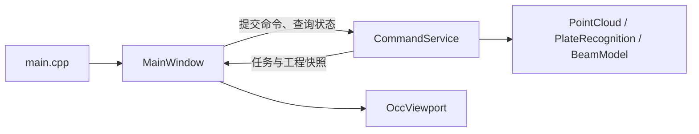

# ReverseModeling 开发指南

本项目是基于 C++20、Qt Widgets 和 OCCT 的点云辅助逆向建模桌面应用。主要流程是：导入 PCD 点云，识别可观测板件的位置和厚度，生成单侧模型，再进行偏差计算和 STEP 导出。底板按两侧板识别厚度的最大值估算，缺少侧板依据时保留底部观测面，手动参数建模作为独立模式。

工程包含两个可执行程序：

| 程序 | 职责 | CMake 入口 |
|---|---|---|
| `ReverseModeler` | 桌面交互、点云与模型显示、建模操作 | [主程序 CMakeLists.txt](CMakeLists.txt) |
| `ReverseServiceTests` | 使用 Google Test 检查几何与命令服务 | [测试程序 CMakeLists.txt](../tests/CMakeLists.txt) |

开发时打开仓库根目录的 [CMakeLists.txt](../CMakeLists.txt)。两个程序直接编译同一份业务源码，工程内部不生成独立业务库。

## 目录与代码入口

```text
PointCloudReverseModeling/
├── CMakeLists.txt               # 总入口，加载两个子项目
├── CMakePresets.json            # 全仓库唯一的构建预设
├── cmake/
│   ├── common.cmake             # C++ 标准、编译选项与输出目录
│   └── Dependencies.cmake       # 全部第三方库查找与公共链接库
├── ReverseModeling/
│   ├── CMakeLists.txt           # 主程序文件清单、头文件搜索目录和链接库
│   ├── ReverseModeling.cmake    # 汇总 core、geometry、commands 的公共文件
│   ├── main.cpp                # QApplication 与 MainWindow 入口
│   ├── core/                   # 点云、参数、网格和结果的数据类型
│   ├── geometry/               # 点云读取、PCA、建模、STEP 与偏差算法
│   ├── commands/               # 异步命令、工程状态与 JSON
│   ├── workbench/              # Qt 窗口与 OCCT 视口
│   └── examples/               # 参数格式示例
└── tests/
    ├── CMakeLists.txt           # 测试程序文件清单、头文件搜索目录和链接库
    ├── tests.cmake             # 测试文件清单
    └── service_tests.cpp        # Google Test 用例
```

建议按以下顺序阅读：

| 文件 | 重点 |
|---|---|
| [main.cpp](main.cpp) | 应用启动与主窗口创建 |
| [MainWindow.cpp](workbench/MainWindow.cpp) | 用户操作、参数面板、任务轮询和界面刷新 |
| [WorkbenchActions.cpp](workbench/WorkbenchActions.cpp) / [RibbonBuilder.cpp](workbench/RibbonBuilder.cpp) | 共用动作、能力标记、Ribbon 与视图工具条 |
| [DockWorkspace.cpp](workbench/DockWorkspace.cpp) | ADS 工具窗口、窗口菜单、布局保存与恢复 |
| [ModelInspector.cpp](workbench/ModelInspector.cpp) | 部件模型树、只读属性、稳定 ID 与三维选择联动 |
| [OccPartMesh.h](workbench/OccPartMesh.h) | 为部件网格提供按真实三角面命中的整件选择实体 |
| [RecentFilesMenu.cpp](workbench/RecentFilesMenu.cpp) | 最近成功导入的点云/模型路径、排序去重、持久保存与清空记录 |
| [WorkbenchPanels.cpp](workbench/WorkbenchPanels.cpp) / [HBeamTemplateFields.cpp](workbench/HBeamTemplateFields.cpp) | H 型钢模板入口、逐板识别结果、镜像选项、手动参数、待接入参数说明和后续操作表单 |
| [WorkbenchTheme.cpp](workbench/WorkbenchTheme.cpp) | 深色主题、自有图标与高 DPI 图标尺寸 |
| [CommandService.h](commands/CommandService.h) / [CommandService.cpp](commands/CommandService.cpp) | 命令入口、任务状态、工程快照和版本控制 |
| [Types.h](core/Types.h) | `CloudData`、`BeamParameters`、`MeshData` 等公共数据契约 |
| [PointCloud.cpp](geometry/PointCloud.cpp) | PCD 读取、单位转换、有效点过滤和 PCA 初值 |
| [PointCloudExport.cpp](geometry/PointCloudExport.cpp) | 全量点云 PCD 写出、回读核对与不覆盖提交 |
| [ModelImport.cpp](geometry/ModelImport.cpp) | STEP/STP、CWRM v2 BRep 解码和导入 |
| [ModelExchange.cpp](geometry/ModelExchange.cpp) | CWRM v2 写出回读、模型表面采样与独立文件转换 |
| [BeamModel.cpp](geometry/BeamModel.cpp) | 板件建模、网格生成、STEP 导出与回读、偏差计算 |
| [PlateRecognition.cpp](geometry/PlateRecognition.cpp) | 从点云顶边条带识别厚度和站位，按两侧板最大值估算底板，保留缺测观测面 |
| [OccViewport.cpp](workbench/OccViewport.cpp) | 点云与三角网格的 OCCT 显示适配 |
| [ModelDisplayData.cpp](workbench/ModelDisplayData.cpp) / [OccModelPresentation.cpp](workbench/OccModelPresentation.cpp) | 按部件归属拆分网格、灰色实体与拓扑轮廓、模型板厚标注及屏幕避让 |
| [ModelLabelVisibility.cpp](workbench/ModelLabelVisibility.cpp) | 板件主表面朝向及模型网格遮挡判断，避免显示背侧板厚 |
| [PointCloudDisplayData.cpp](workbench/PointCloudDisplayData.cpp) | 中立点云显示采样与紫青高度渐变 |

## 业务调用流程



1. **导入文件**：STEP/STP 和 CWRM 经 `loadCadModel()` 直接创建模型，替换当前点云/模型并清空编辑历史；PCD 路径为：`MainWindow` 调用 `submitImport()`，后台依次执行 `loadPointCloud()`、`estimateBeam()` 和 `recognizePlates()`，得到点云、初始方向及逐板识别结果；识别失败保留点云与原因，不填经验板厚。
2. **生成模型**：默认通过 `submitRecognizedReconstruct()` 调用 `buildRecognizedPlates()`，构建各板件的识别尺寸，底板按两侧板厚最大值向观测面背侧生成实体，宽度夹在翼板内侧面之间，翼板下沿延伸到其底面；缺少任一侧板可靠识别值时保留底部观测面。镜像默认关闭，开启后明确记录镜像部件的来源。显式手动模式继续通过 `submitReconstruct()` / `buildBeam()` 建模。
3. **更新显示**：界面通过定时器轮询 `task()`，读取 `project()` 返回的工程快照，再更新参数、日志和 `OccViewport`。
4. **导出与偏差**：`submitExportCloud()` 写出当前全量点云，`submitExport()` 执行 STEP 写出及独立回读检查；`submitDeviation()` 计算点到当前模型板件表面的距离。

服务与几何接口见 [CommandService.h](commands/CommandService.h) 和 [Geometry.h](geometry/Geometry.h)。[Json.h](commands/Json.h) 提供任务、工程摘要的序列化和参数解析，当前 `schemaVersion` 为 1，摘要不携带点云或网格大数组。

### 数据与线程约定

- 内部尺寸统一为 **mm**；PCD 桌面导入固定使用 mm，底层接口仍接受 mm、cm 或 m；STEP 读取文件单位并转换到 mm，CWRM 按 mm。`CloudData` 中的点使用局部坐标，项目坐标为 `position + originMm`；`MeshData` 顶点使用项目坐标。
- `CommandService` 使用一个常驻工作线程和有界 FIFO，最多排队 64 条请求；各命令顺序执行。按钮、命令窗口和 Python 经过同一参数检测与分发入口，QWidget 和 AIS 对象由 GUI 线程操作。
- 重建、导出和偏差命令携带 `expectedRevision`，旧版本请求会被拒绝。导入或重建成功后更新工程版本；失败保留原有结果。
- 取消通过 `std::stop_token` 协作完成。关闭窗口先调用 `requestShutdown()`，GUI 定时查询 `shutdownComplete()`，解释器在工作线程清理完毕后才关闭窗口；单次 OCCT 内核调用可能需要等待其返回，等待期间 GUI 继续响应。
- 当前工程状态保存在内存，任务与资产 ID 在本次服务生命周期内有效。

## 桌面工作台

`MainWindow` 继承 `SARibbonMainWindow`，使用 `UseRibbonMenuBar | UseNativeFrame` 保留原生系统标题栏。SARibbon 组织顶部功能区，单层 ADS 管理固定中央视图和六类工具窗口。视图容器、日志及工程摘要由 `MainWindow` 装配，视图工具条由 `RibbonBuilder` 创建，重建参数与操作表单集中在 `WorkbenchPanels`；各文件入口见上方代码表。

布局与交互参考 CypModeler 截图及灵控平台 `D:/projectWQZ/ProjectManager/project/LingkongPlatformLauncher/src/LingkongPlatformLauncher/Launcher/MainWindow.cpp`。主要借鉴其 Ribbon 分组、组件尺寸和 OCCT 容器用法；本工程使用独立的主题与单层 Dock 管理，不引入灵控的插件系统、嵌套 QDockWidget 或构建包装。截图只提供 UI 参考，不能据此认定对应算法或文件格式已经实现。

### 工具窗口与布局生命周期

| 窗口 | 稳定 `objectName` | 初始停靠位置 | 当前内容 |
|---|---|---|---|
| 模型树 | `dock.modelTree` | 右侧上方 | 工程、点云、模型及实际部件；名称、颜色和板厚，与三维选择联动 |
| 命令窗口 | `dock.commands` | 仅中央视图下方，默认显示 | 命令输入、运行日志/警告/结果、复制所选、清空输出和宏录制/回放 |
| 属性 | `dock.properties` | 右侧下方 | 当前对象的只读信息；部件 ID、板厚依据、网格包围盒、来源等 |
| 重建参数 | `dock.reconstruction` | 左侧 | 逐板识别结果、默认关闭的镜像选项及独立手动参数模式 |
| 操作面板 | `dock.operation` | 左侧，与重建参数同组，默认激活 | 移动、旋转、基准面、孔洞等操作表单 |
| 任务信息 | `dock.tasks` | 底部，与命令窗口同组，默认隐藏 | 当前任务名称、状态、阶段和进度，不维护历史任务列表 |

中央三维视图使用 `dock.viewport`，不可关闭、移动或浮动，不列入窗口菜单。默认左侧整列显示重建参数和操作面板标签组，激活操作面板，贯穿工作区全高；中央列由三维视图和命令窗口上下平分；右侧整列由模型树和属性上下平分。左右侧栏初始宽度约为 340 像素，中央视图占据其余宽度。任务信息按需打开。同侧窗口可标签化组合，自动隐藏侧边栏暂未启用。窗口菜单直接复用 `CDockWidget::toggleViewAction()`，勾选表示窗口已打开，标签被其他窗口遮挡不代表关闭。

关闭辅助窗口等价于隐藏，不启用 `DockWidgetDeleteOnClose`，重开沿用原实例及内容。Ribbon“重建参数”和窗口菜单指向同一个 Dock，重复打开只显示并激活该窗口。“隐藏所有辅助窗口”保留中央视图、Ribbon 和状态栏；“恢复默认布局”恢复左侧工具页、底部命令窗口和右侧模型树/属性，隐藏任务信息，不清空点云、模型、日志或参数。

布局在 `QSettings` 的 `ui/layout/v4` 组保存主窗 `geometry` 和 ADS `docks` 状态，ADS 布局版本为 4；首次使用新布局仅继承 v3 的主窗大小与位置（缺失时回退 v2），不沿用旧停靠排列。启动顺序为：设置 ADS 全局配置 → 创建中央 Dock 并调用 `setCentralWidget()` → 注册全部工具 Dock → 捕获默认布局 → 恢复用户布局。恢复失败回退默认快照，并检查主窗与浮动窗口标题栏是否仍在可用屏幕范围内。正常关闭流程被接受后才保存布局；有后台任务时先请求取消并等待安全退出。窗口集合或保存格式发生不兼容变化时同步升级配置组与布局版本。

首次进入 v4 使用新的默认排列；正常关闭后继续记忆用户手动拖动、调整尺寸及显隐状态。“恢复默认布局”按当前窗口尺寸重新分配区域，不清空业务内容。原 `dock.log` 不再注册，其功能已合并到命令窗口。

### 动作、参数与后续接入

“打开 → 最近打开文件”由 `RecentFilesMenu` 管理，最近 10 条路径保存在 `QSettings` 的 `files/recentPointClouds` 中。仅在导入任务成功后加入或前移记录；菜单重开与普通打开共用 `MainWindow::importCloud(path)`，按扩展名分派导入，忙时不可提交。完整路径用于区分同名文件，Windows 路径去重忽略大小写；失效文件保留记录但禁用，清空不触及源文件。

`WorkbenchActions` 统一创建 QAction、稳定名称、快捷键和能力标记，供 Ribbon、菜单及快捷键共用。`MainWindow` 根据项目快照、任务和参数修改状态更新可用性：已有业务正常提交服务；表单预览动作只打开输入界面，执行按钮禁用；尚未接入的命令整体禁用并说明原因。忙时仍可查看日志和切换工具窗口。

工具图标和菜单项的悬停帮助由 `WorkbenchActionHelp` 统一维护，包含作用、操作方法、使用条件和已有快捷键；置灰时也可查看说明。撤销/重做的当前操作、基准面禁用原因和导出目录通过 `setActionHelpContext` 追加，状态刷新不覆盖固定帮助。新增动作时同步补充说明，不将未接入功能描述为已实现。

| 功能区域 | 已有能力与预留入口 |
|---|---|
| 文件 | 导入 PCD、STEP/STP、CWRM；导出当前点云 PCD、模型 STEP/CWRM、模型表面采样 PCD；打开文件夹及参数导入/导出待接入 |
| 编辑与点云 | 框选、加选/减选、截取保留选区、删除选区、点云/模型统一撤销、重做及导入基线重置可用；已删除不适用于当前 PCD 重建流程的对齐、拼接去重、2D 识别精度占位菜单 |
| 重建 | 参数、开始重建、停止重建与局部重建连接现有服务；局部重建只替换选中部件 |
| 模型修改 | 板厚/轮廓调整、外扩贴板/下底板支持预览和真实建模；过焊孔/底边孔支持底边定位、预览及真实切除；圆角/倒角支持边线处理、异步预览和应用；体模式下可移动、旋转和删除选中部件；钢结构分组提供镜像补全 |
| 工具 | 测量支持可见模型/点云两点距离及 XYZ 分量；基准面支持三点/特征面定义、预览确认与正视；计算偏差使用现有服务 |
| 视图工具条 | 点云/实体显隐、高度渐变、可见侧板厚、适合视图、底板正视和方向立方体可用；点云框选、模型点/线/面/体拾取可用；基准面点云剖视可用；线框待接入 |

模型选择：点/线/面/体分别拾取真实 BRep 顶点、拓扑边、完整面和部件；视口高亮当前对象，属性显示类型及部件内编号，模型树定位所属部件。顶点和边不使用显示网格细分线或包围盒。被模型面遮挡的对象不拾取。生成或导入模型后自动切到“可选：体”，左键单击部件高亮，并选中模型树对应节点、显示属性；点击树节点会显示模型并高亮对应部件。空白单击或 Esc 清空选择，隐藏模型或替换资产时清除旧选择。模型树区分点云、重建模型、STEP/CWRM 模型；按稳定部件 ID 关联，不依赖树行号或网格顺序。属性只读，板厚以一位小数显示，厚度依据说明来源，不追加“估算”提示；导入模型不推测板厚。包围盒来自该部件显示网格的项目坐标，沿世界坐标轴排列，尺寸不能当作局部板厚。

“可选：点 / 线 / 面 / 体”均支持批量选择：普通点击替换，Shift 或 Ctrl 点击追加，再点已选对象取消；工具条“加选”累加、“减选”移出。子对象通过部件 ID、类型和编号区分，同一部件的多条边或多个面分别高亮；属性框显示选中数量与对象列表。切换类型、普通点击空白或 Esc 清空选择，Shift 点击空白保留选择。模型树支持 Ctrl / Shift 多选，与视口高亮和多选属性同步。选中至少一个部件时“删除模型”可用；点/线/面模式、测量及基准面拾取期间禁用。

删除通过后台 `model.delete --parts '["imported-part-1","imported-part-3"]'` 执行，命令窗口回显且可录制重放，不依赖当前选区。模型树、板厚标注、测量/拾取拓扑和 STEP 导出同步移除部件；剩余部件 ID、颜色、坐标及板厚保持不变。不存在的 ID 整条拒绝，全部删除后清空模型并禁用导出，保留点云和源文件。删除进入统一工程历史，`project.undo/redo` 可恢复或再次删除同一组部件；重置可恢复完整导入模型。

`ModelInspector` 仅在模型资产变化时重建部件树和属性缓存；选区、导出状态变化不重建树。`OccPartMesh` 扩展 `AIS_Triangulation` 的整件选择实体，按三角面命中而非包围盒；`OccModelPresentation` 显式注册并激活选择模式，标注和引线不参与选择。方向立方体的点击优先处理。选择与高亮只属于 GUI 状态，不改变服务模型或导出几何。

点云编辑：切换到“可选：点”后左键拖动矩形框选，选择工具条中的“选择 / 新增选择 / 移除选择”切换替换、加选和减选。橙色矩形表示框选范围，蓝色表示选中点；右键单击打开“截取点云 / 删除点云”菜单，右键拖动仍旋转视图。“截取点云”只保留选中点，“删除点云”移除选中点；未选点或点云隐藏时禁用。单击空白（替换模式）或 Esc 清空选区。框选贯穿当前相机视锥深度，包括遮挡点，作用于完整点云，不只处理最多 20 万个显示点。

`CloudSelectionRect` 保存局部毫米坐标到相机裁剪空间的矩阵与矩形；`geometry/CloudEditing` 处理投影、增减索引和过滤，不访问 Qt / AIS。过滤保留原始 `sourceIndex`、强度、单位和显示原点，重算当前包围盒；原始文件点数与当前有效点数分开统计。`PointCloudDisplayData::pointIndex` 将显示采样映射到当前完整点云选区，选择本身不改变识别和模型。

截取或删除通过 `CommandService` 后台执行，成功时原子更新点云、重算 PCA / 板件识别，保留旧模型及部件点云关联，清除偏差与导出状态；识别失败保留编辑后的点云并给出提示。删除全部点允许得到空点云，不能继续重建。失败或取消保留操作前状态。编辑不写源 PCD 文件；全选后截取不改变数据或模型。

撤销/重做统一覆盖点云截取/删除、模型重建/参数建模、部件删除及已确认基准面，最多保留 10 步；恢复点云、识别、真实几何、稳定部件 ID 和已提交参数，清空临时选区、测量及旧偏差/导出缓存。重置恢复本次导入的完整点云或 STEP/CWRM 模型，重置也可撤销；新编辑清空重做，重新成功导入建立新基线。`ProjectHistory` 在产品层管理共享不可变内容，输出目录、磁盘文件和录制状态不回滚。`ReplayJournal` 独立保留当前会话必要命令过程，中途开始录制自动补写；撤销、重做、重置各追加一条 `project.*` 命令，不删改脚本旧行。Delete、Ctrl+Z、Ctrl+Y 仅在视图区有焦点时执行点云删除、撤销和重做，不影响参数输入。编辑后相机位置保持不变，可双击或使用“适合视图”重新居中。

“停止重建”仅取消重建任务；其他任务使用状态栏的“取消任务”，命令窗口使用“中断”或 Ctrl+C。命令窗口统一以 `rm>` 输入和回显原生命令；录制文件沿用 `.py` 扩展名，建模命令直接写命令名及参数，无包装和模块版本。命令窗口和脚本也支持 `print()`、变量、import、循环及 input；多行输入以空行结束。回放逐条回显实际执行的建模命令，未捕获错误显示行号并停止，Python 和业务执行始终在同一工作线程。新增 UI 命令通过 `CommandService` 提交，在实际执行时检查 `expectedRevision`；Qt、SARibbon、ADS 类型不进入 `core`、`geometry` 或业务服务契约。命令定义、手写业务、Python 适配和使用方法见[命令框架与 Python 使用指南](../docs/命令框架与Python使用指南.md)。

重建面板默认展示逐板厚度和依据：侧板、肋板提示支持点数及截面离散度，底板显示“侧板最大值”并说明公式；不加载经验板厚和固定肋板站位。独立的“端部突出容差”已接入 `PlateBuildOptions`，默认 30 mm，0 关闭；只收齐沿梁长方向的小突出，超过阈值的长度保留并告警。修改后需重建，模型 JSON 保存本次容差。镜像默认关闭，只在显式开启时沿底板中面（未定厚时为观测面）补建并标识为镜像来源。未识别板厚显示“未识别”，仅构建观测面。手动模式单独提供尺寸、板厚和站位输入，不自动填参考板厚；编辑/选项变化后需重建，完成前禁用 STEP 导出及偏差计算。模板选择器仅列出 H 型钢默认模板，建模方式使用独立控件。`HBeamTemplateFields` 集中组织 7 项基础参数、19 项高级参数和文本帮助，替换原油箱占位表单。所有参考算法项禁用，不接入命令服务、不保存为识别配置；展开高级参数、查看帮助不将模型标为过期，也不产生几何变更。密度等口径未明确的参数在帮助中标明，不能猜测为点数或面积密度。

操作面板共用一个 Dock，在内部切换表单。“模型调整”页顶部提供固定下拉框，与 Ribbon 菜单共用动作列表和使能状态，仅列出已实现的修改板厚、外扩轮廓、外扩贴板、下底板和镜像补全；“镜像补全”归在“钢结构”分组下，分组标题不作为可执行选项。切换会取消未应用预览并同步拾取模式，只有应用才提交并录制命令。移动、旋转支持真实实体变换及预览，采用“确定提交、取消放弃”；添加孔支持等厚实体的过焊孔和底边孔，先预览再应用；其他待接入表单仍禁用几何执行。取消或切换操作会清理对应草稿，不让输入变化直接修改正式模型。

测量独立于操作表单：`PointMeasurement` 管理两点状态并计算毫米距离，`OccViewport` 通过 OCCT 选择器的空间索引拾取可见三角面/显示采样点，`OccMeasurementPresentation` 绘制不可选择且不参与适合视图包围盒的端点、距离线和结果卡片。XYZ 为工程轴的绝对坐标差；显示原点平移不影响结果。`MeasurementSnap` 缓存真实拓扑顶点的屏幕投影，在 16 个逻辑像素范围内按距离和可见性捕获；橙色端点表示已吸附，普通命中为白色。缩放、旋转和 DPI 变化会更新投影，遮挡通过 OCCT 射线查询排除；未捕获时回退到面/点云命中。第二点支持悬停预览，完成后第三次点击重开；Esc、右键“退出测量”及测量按钮均可退出。计算与少量标注刷新在视图线程执行，不遍历完整原始点云；不修改工程数据、不进入录制脚本。曲面距离以显示三角面交点为准，非 CAD 精确曲面测量。

### 原生视口、主题与依赖

`OccViewport` 通过 `ForceNoScrollArea` 放入固定中央 Dock，普通 QWidget 工具条与原生视口上下布局；下拉菜单使用独立弹窗，不在原生绘制区上叠加透明输入层。保留已有 `WinIdChange` 和 resize 处理。原生 OCCT 视口启用最高 8 倍 MSAA 抗锯齿，按显卡能力降到 4 倍、2 倍或关闭，平滑实体轮廓、拓扑边和选择高亮；不修改模型几何或导出数据。视图导航参考 CamAssemblyWelding 的 `AIS_ViewCube`：右上角固定锚点随设备像素比缩放，不计入工件包围盒，独立检测立方体面/棱/角；Qt 定时器驱动相机动画并同步板厚标签遮挡，手动导航会中断动画。`BottomView` 动作取当前模型（无模型时取识别结果）的底板法线与长轴，设置正交相机和屏幕向上方向后适合视图，不变换点云或模型坐标。参数表单内部可使用 `QScrollArea`，工具 Dock 从内容最小尺寸获取约束；修改布局时关注分隔条、浮动面板及窄窗口下的内容裁切和鼠标坐标，不无差别设置 `WA_NativeWindow`。

模型显示使用 `MeshData::trianglePartIndices` 和 `partIds` 拆分部件，不依赖三角形连续排列。`ModelDisplayData` 将网格与同次建模的 `ModelSummary` 转成中立显示数据，板厚优先读取模型快照中的 `thicknessOverrides` 手动编辑记录；未编辑部件读取逐板识别记录；手动模型读取手动参数，不能覆盖识别模型的未识别状态；底板的 `inferred_side_plate_max` 来源传递为 `thicknessEstimated`，三维标签统一显示毫米厚度，属性/JSON 保留该来源和未取整的厚度；未选部件统一为浅灰色哑光实体，使用深色真实拓扑轮廓区分板件；选中为浅青填充和蓝色轮廓，悬停为更淡的灰青色，选中部件的板厚标签使用橙底白字；未知角色不猜测板厚。`OccModelPresentation` 为各部件创建独立 AIS 网格，通过自有 `Prs3d_ShadingAspect` 设置不透明配色。每块板件取两个主表面候选锚点，`ModelLabelVisibility` 按相机方向及视线与模型网格的交点筛选可见侧；背面、掠视或被遮挡的标签不参与屏幕避让。标签和引线在 OCCT 内绘制，保持屏幕字号且不参与 FitAll 包围盒。重建或重新导入时替换原呈现，隐藏实体同步隐藏其标注。配色及标签属于显示层，不改变业务几何、STEP 数据或用户参数。

`PointCloudDisplayData` 在最多 20 万个显示采样点上计算沿 PCA 短轴的高度，使用 2% / 98% 分位数映射紫青色域；退化高度使用中间紫色。`OccViewport` 通过 `Graphic3d_ArrayOfPoints` 的逐点颜色绘制，默认开启“高度渐变”，纯色模式使用青色。只在更新点云、选区或切换模式时重建显示数组，旋转、平移和缩放不重算配色。桌面选择 PCD 后固定按 mm 提交导入，不再显示单位确认或切换弹窗。

主题入口为 [WorkbenchTheme.cpp](workbench/WorkbenchTheme.cpp) 和 [workbench.qss](workbench/resources/workbench.qss)，资源通过 `.qrc` 管理。当前采用深蓝黑背景、青蓝强调色和浅色文字：视口背景 `#081521`、面板背景 `#0B202A`、强调色 `#1EA7D8`、主文字 `#DCE4EA`。图标由 QPainter 绘制多个尺寸及禁用状态，不裁剪参考软件图标，也不额外依赖 QtSvg。主窗口与 ADS 使用统一 QSS，避免库的默认主题覆盖；Ribbon 中文字体、分组标题高度和图标尺寸需协同调整，布局尺寸使用逻辑像素。

应用图标独立于工具栏图标：自有 [ReverseModeler.svg](workbench/resources/app/ReverseModeler.svg) 用紫色采样点过渡到青蓝实体表达点云逆向建模。生成的 ICO 包含 16、20、24、32、40、48、64、128、256 像素九个尺寸，Qt 全局窗口图标与 Windows EXE 的 RC 资源共用此文件；Windows 启动前设置稳定的进程 AppUserModelID，主窗口首次显示前同时指定窗口 AppUserModelID、任务栏图标资源、显示名与重新启动命令，避免只更新标题栏而遗漏任务栏分组图标。路径从当前运行的 EXE 动态取得，不写死开发目录；窗口销毁前清除所设置的 Shell 属性。CMake 编译、安装和打包自动带上嵌入图标，运行时不读取外部图片。修改 SVG 后，在仓库根目录执行 `python pythonProject/generate_app_icon.py --inkscape "D:/app/Inkscape/bin/inkscape.com"` 更新 ICO 和预览 PNG。Inkscape 仅用于维护美术资源，不属于正常构建或运行依赖。

[Dependencies.cmake](../cmake/Dependencies.cmake) 统一查找 `SARibbonBar 2.8.0` 和 `qtadvanceddocking-qt6 4.5.0`。[主程序 CMakeLists.txt](CMakeLists.txt) 仅为 `ReverseModeler` 链接 `SARibbonBar::SARibbonBar` 与 `ads::qtadvanceddocking-qt6`，并启用 `AUTOMOC`/`AUTORCC`；两个 UI 库不加入 `RM_COMMON_LIBRARIES` 或服务测试目标。继续通过安装前缀消费匹配的 SDK，不引入第三方源码构建。运行时 DLL、Qt 插件和 OCCT 资源要求见[根 README](../README.md#构建与运行)，正式分发需保留所用库的许可证文件。

## 修改代码与添加文件

头文件与源文件放在同一功能目录，各目录的同名 `.cmake` 分别使用 `RM_SOURCES` 和 `RM_HEARDERS` 汇总文件。**每个文件单独一条追加语句**：

```cmake
list(APPEND RM_SOURCES "${CMAKE_CURRENT_LIST_DIR}/Example.cpp")
list(APPEND RM_HEARDERS "${CMAKE_CURRENT_LIST_DIR}/Example.h")
```

`RM_HEARDERS` 是当前工程约定的变量名称。两个程序的 `CMakeLists.txt` 分别初始化文件清单并创建目标；公共文件由 [ReverseModeling.cmake](ReverseModeling.cmake) 汇总。主程序专用的 `main.cpp`、`workbench` 和测试专用的 `tests.cmake`，分别在对应程序的 `CMakeLists.txt` 中加入。

| 修改内容 | 维护位置 |
|---|---|
| 点云或几何算法 | `geometry/` 及 `geometry.cmake` |
| 命令、任务或工程状态 | `commands/CommandService.*`；公共数据类型放在 `core/Types.h` |
| 板件厚度及站位识别 | `geometry/PlateRecognition.cpp` |
| 界面与显示 | `workbench/` 及 `workbench.cmake` |
| 新增公共模块 | 新建同名 `.cmake`，由 `ReverseModeling.cmake` 包含 |
| 新增第三方依赖 | 在 `Dependencies.cmake` 查找；公共链接库加入 `RM_COMMON_LIBRARIES`，程序专用库在对应 `CMakeLists.txt` 链接 |
| 新增测试 | `tests/service_tests.cpp`；新增测试文件时逐个加入 `tests/tests.cmake` |

## 单元测试

测试程序位于独立的 [tests/](../tests/) 目录，直接编译公共服务实现。现有用例覆盖单位、点云属性、逐板识别、缺测厚度、镜像、几何与偏差、取消及异常输入，以及服务版本控制、失败保留和 STEP/JSON 往返。配置、构建与运行方式见 [测试程序说明](../tests/README.md)；工程整体环境与运行说明见 [根 README](../README.md)。

## 当前能力边界

- 桌面 UI 框架及现有业务入口已接入；当前唯一模板为 H 型钢；点/线/面/体选择和只读属性已接入，属性编辑、新几何操作、剖切、线框及其他工件模板算法仍待实现。各入口状态见[桌面工作台](#桌面工作台)。布局记忆不保存点云、模型和参数。
- 支持 PCD 的 ASCII、binary、binary_compressed 格式。内存中保留 XYZ、intensity、源点索引、字段名称和无效点计数，其他字段保留在原文件中。
- PCA 与底部观测面拟合提供方向；当前从单侧正交板件的连续顶边条带识别各侧板、肋板的厚度和实际站位。沿条带分段计算横向 2%–98% 宽度，以中位数汇总并记录截面四分位差。缺少连续支持或厚度不稳定时不补板件，不把投影包围厚度当成测量结果。底板尚无可靠双面测厚：两侧板均通过识别时，采用未取整厚度的最大值，并记录 `inferred_side_plate_max`，这是建模估算而非底板实测值。观测面作为底板上表面，向背侧加厚；底板横向边界使用两翼板内侧面，翼板下沿贴合底板底面，肋板底面仍接底板上表面。各翼板的纵向端部独立识别；建模时仅在容差内将底板端部突出收齐到翼板共同范围，保留超阈值突出与原始识别记录。镜像时两半翼板在底板中面分界，避免底板厚度范围内出现重复实体。任一侧板证据不足时保留底部观测面。自动双面板厚、任意曲面和局部孔洞识别仍未实现。
- 默认模型由识别的单侧板件和最大值估算的底板组成，依据不足时底板为观测面；开启镜像才补建另一侧。偏差计算针对有限矩形板件表面，包含端面与边界；任意 CAD 模型的通用距离计算尚未实现。
- 当前点云导出为 binary PCD，使用 float64 XYZ 项目坐标（mm），存在 intensity 时一起保存；不包含未保留的 RGB 等字段或内部源索引。`cloud.export` 仅导出当前全量点云，空点云或只有模型时禁用。单独的 `model.export_pcd` 按模型三角表面采样，只输出 XYZ，最多五百万点；曲面精度受三角网格离散影响，不替换工程点云。
- 模型导入保留实体/独立曲面及位置，展开装配实例并按部件使用本程序配色；不保留装配树、原名称/颜色、线/点对象或来源软件的编辑历史。导入模型不推测板厚，不参与矩形板件偏差算法。CWRM 当前支持 v2、`shape_type=brep`：Base64 + AES-128-ECB 零填充，解码后读取头部及 OCCT BRep；编码/版本不匹配或文件损坏时拒绝并保留当前工程。通过 OpenSSL 3 Crypto 处理，不依赖安装柏楚程序。
- PCD、STEP、CWRM 均支持 Windows 中文目录/文件名；临时文件检查完成才提交，取消或失败不覆盖原文件。CWRM 导出保存 v2 BRep 几何，回读核对数量、体积及位置，不保存本程序的命令历史、点云或重建参数。
- `file.convert` 独立读取 STEP/STP 或 CWRM，可写出 STEP/STP、CWRM 或模型采样 PCD，不改变当前工程和撤销历史。PCD 输入一律拒绝，包含 PCD 转 PCD；正常导入点云、手动重建及各自导出仍可使用。新增导出及转换可录制，外部文件写入不会随工程撤销，也不在中途开始录制时补写。用例见[文件导入导出与格式转换](../docs/文件导入导出与格式转换.md)。
- STEP 导出检查实体有效性，并独立回读核对实体数、独立观测面数、体积和包围尺寸等结果；目标文件已存在时拒绝覆盖。
- 尚未提供跨进程工程持久化、自动轮廓与孔洞恢复或 Web 服务。

手动参数格式示例见 [beam-parameters.json](examples/beam-parameters.json)，其中数字仅演示格式，不作为识别默认值。桌面参数通过界面编辑，当前未提供该 JSON 文件的导入入口。研究背景与后续方案见 [参考资料入口](../reference/README.md)，Python 扩展约定见 [Python 脚本编码规范](../docs/Python脚本编码规范.md)。

### 基准面与点云剖视

“工具 → 基准面”在操作面板中提供两种方式：三点方式依次拾取点云或模型表面，靠近模型顶点时吸附；特征面方式拾取 STEP/CWRM 或重建模型的一个平面。选满后显示半透明预览及法线 N，点击“确定”提交；“反转法线”改变点序。重复点、共线点和曲面不会作为有效定义。取消、Esc、右键“退出基准面设置”或切换操作页丢弃草稿，保留已确认平面。

确认后可点击右上角“基准面”或面板“正视基准面”，沿法线观察。视图工具栏“剖视”打开同一面板的点云剖视设置：勾选启用、填写毫米偏移、选择是否反向保留后，点击“应用剖视”。偏移沿原法线，反向只改变保留哪一侧。剖视只过滤点云显示，**框选仍贯穿深度，重建和 PCD/STEP 导出仍使用完整数据**。新文件导入清除基准面；截取、重建保留基准面，确认设置/清除基准面会进入工程历史，可单独撤销/重做。撤销到无基准面的状态时自动关闭剖视。

依据本机 CypModeler 的 `resources/webapp/chunk/main.js` 中基准面命令、剖视管理和 `PCRView.js` 的界面逻辑分析：三点/特征面提交的是视图参考平面，正视改变相机，剖视给点云添加裁剪平面，不旋转原始点云或修改板厚。参考软件还将它供手工拉伸建模使用；本工程的手工拉伸尚未接入，本次没有改变自动重建算法。

基准面及剖视使用统一命令服务，GUI 与命令窗口显示和录制一致，`.py` 脚本直接保存以下形式；坐标是毫米工程坐标（已加回显示原点），不是屏幕像素或局部坐标：

```text
project.set_reference_plane --points '[[0,0,0],[100,0,0],[0,100,0]]'
project.section --enabled true --offset 10 --reverse false
project.section --enabled false
project.clear_reference_plane
```

`project.snapshot` 包含 `referencePlane` 和 `section`；各命令支持 `-h/--help`。业务状态位于 `ProjectSnapshot`，几何校验位于 `geometry/ReferencePlane`，UI 草稿和异步提交位于 `workbench/ReferencePlaneTool`。特征面使用 OCCT 曲面类型标志与真实面编号，不用三角网格的局部平坦程度推断。

### 部件移动与旋转

“可选：体”下选择一个或多个部件，再点击“移动”或“旋转”。支持模型树 Ctrl/Shift 多选。移动使用项目 X/Y/Z 毫米位移；旋转使用项目坐标系单轴 X/Y/Z、公共旋转中心和有符号角度，单次范围 -180°～180°。从轴正向朝原点看，正角逆时针，负角顺时针。初始中心取所选部件整体包围盒中心，可修改为准确项目坐标。

输入数值或拖动彩色轴柄时，实体显示实时响应，青色轮廓和半透明几何保留原位置作对照。旋转只显示当前轴的圆环，不能任意自由转向；没有缩放操作。预览冻结所选目标，不改变工程几何、历史或脚本。取消、Esc、右键取消、切换面板或工程状态变化都会清除预览；确定后工作线程修改实际 BRep 并产生一个撤销步骤。模型树包围盒、拾取、测量、板厚标签及 STEP 导出使用变换后的结果；点云和已定义基准面保持项目坐标不动。

新增 `model.move --parts ... --offset ...` 和 `model.rotate --parts ... --axis ... --angle ... --center ...`，GUI、命令窗口及脚本共用参数检测和业务。确认后的完整命令包含稳定部件 ID、位移或轴/角度/中心，支持即时录制、中途录制补写及回放。无变化和非法请求不新增历史、不截断重做分支。

实现分工：`geometry/ModelTransform` 处理纯坐标数学，`BeamModel` 复制选中部件拓扑并变换，`ModelSummary::partTransforms` 保留累计项目变换；矩形板件偏差使用每个部件的变换框架。`workbench/ModelTransformTool` 管理编辑草稿，`OccTransformPreview` 管理 AIS 原位置参照和受约束的手柄。参考本机 CypModeler 的 `RotateByCenterStrategyImpl` / `CmdModelRotate` 的中心旋转与预览提交分离方式；没有复制其界面资源。

### 圆角与倒角

点击“圆角/倒角”自动进入线选择。普通点击一条边，按住 Shift 追加同一实体或其他部件的边（Shift 再次点击已选边取消），输入毫米数值后按回车，或点击“预览”。操作针对等厚板件的平面轮廓，保持板厚不变：选择直线轮廓边处理它两端尚未光顺的板角；选择贯穿板厚的短角边只处理一个角。前后面同一角和相邻边涉及同一角会去重。圆角使用轮廓半径 R；倒角为轮廓等距倒角，两侧距离均为 D。半径受板长、板高及相邻轮廓空间限制，不以板厚作为上限。“对比原模型”可暂时查看应用前的形状；“应用”才真正修改几何并生成一条命令。修改参数会使旧预览失效，退出、切换工具或 Esc 放弃预览。

选中的边按部件分组，每组在当前实体副本上计算，所有部件成功才统一应用。任一部件失败会报告部件 ID，整批保持原模型；一次应用只生成一条命令和一个撤销步骤。不保存可重新编辑的特征参数。已应用的结果需要调整时，先撤销该操作，再重新选边、预览和应用。

`geometry/PlateOutlineTreatment` 识别两个平行主面及等厚侧面，将所选 BRep 边转换为贯穿厚度的板角边。`geometry::treatModelEdges` 使用 OCCT `BRepFilletAPI_MakeFillet/MakeChamfer`，对复制的 BRep 构建、检查实体有效性并更新显示网格。边编号保留原始 BRep 编号，不用三角化内部线。`ProjectOperations` 提供无副作用预览；`CommandService` 在统一工作线程处理计算和取消。预览不改变工程版本、历史、录制或导出，应用命令纳入工程撤销、重做、重置与会话补写。

当前支持平行主面、平面或圆柱侧面的等厚板件轮廓；非等厚实体和已有光顺圆角会明确提示。不支持开放观测面、截面磨边、变半径圆角或非等距倒角。STEP 导出保存最终几何。圆角/倒角改变了矩形表面，因此包含此类部件的模型禁用现有矩形板件偏差算法，避免输出失真的偏差结果。


### 添加孔

从“添加孔”下拉菜单进入“过焊孔”或“底边孔”，在体模式下单选一个等厚实体板件（重建模型和 STEP/CWRM 导入实体均可）。

面板顶部将“过焊孔 / 底边孔”横向并排；“形状”分组内将“圆形 / 三角形”（底边孔为“圆形 / 矩形”）横向并排，点击直接切换。“位置”分组显示底边、端点勾选或参考点与偏移。

- 过焊孔：在底边端点 1、2 切除贯穿板厚的缺口，可分别勾选。圆形尺寸为半径；三角形尺寸为直角边长。
- 底边孔：圆形用半径，矩形用总宽及切入板内的高度。参考点可选端点 1、中点、端点 2。端点的正偏移朝板内，中点的正偏移朝端点 2；中心不能超出底边。
- 底边：自动建议基准面朝上方向的下边；没有基准面时，重建模型采用底板方向，导入模型采用项目 Z 向上。必须核对视图中的 **1／中／2** 标记；导入姿态特殊时通过“底边”下拉框切换。编号与当前视角无关。
- 选中板件并识别底边后，直接叠加绿色半透明切孔体：圆形显示圆柱，三角形/矩形显示对应棱柱，贯穿板厚。修改尺寸、底边、孔位勾选、参考点或偏移时同步更新；切孔体不参与拾取、适合视图或导出。
- 输入数值按 Enter 或点击“预览”，显示实际切除效果并保留绿色切孔体；“对比原模型”隐藏绿色预览、查看修改前的形状。只有“应用”才修改实体并录制命令。参数改变会使旧切除结果失效；退出、Esc 或切换工具丢弃全部预览。绿色预览和正式开孔共用 `plateHoleTools`，保证尺寸和位置一致；非法参数清除旧绿色预览并显示原因。
- 应用使用 `model.add_hole`，显式记录部件 ID、底边 BRep 编号、孔类型、形状和尺寸/位置。支持统一撤销、重做、重置、脚本回放及 STEP 导出；预览不进入历史或录制文件。

当前支持主面平行、侧面为平面或圆柱面的等厚板件，底边必须是主面外轮廓直线边；独立曲面和变厚实体会明确报错。过大的孔导致板件分裂或切空时拒绝提交。圆角、倒角和开孔后的实体不再使用矩形板件偏差算法。再次开孔按当前实体的底边计算；调整已经应用的孔请先撤销再应用。

实现入口：[HoleTool](workbench/HoleTool.cpp)、[PlateHoles](geometry/PlateHoles.cpp)、[model 命令说明](../docs/commands/model.md)。


### 修改板厚

也可直接双击三维视图中可见的数字板厚标签，在标签位置输入毫米值，回车提交；Esc 或点击外部取消。只修改该标签对应板件，不受此前多选影响。提交仍使用 `model.set_thickness`，后台计算，支持命令回显、录制回放与撤销重做。没有改值、取消或仅打开编辑器不产生修改。测量、基准面拾取、几何预览和任务执行期间不进入标签编辑；标签隐藏时也不可命中。板厚标签、模型树、属性、重建板厚表与板厚输入框统一保留一位小数，不追加“估算”提示；内部识别值及来源记录保持原精度。双击标签后未改值直接回车，不因显示舍入修改实体。

“模型调整 → 修改板厚”自动切换体选择，支持 Shift 追加或取消多个板件。后台从两个平行主面读取实际厚度并填入面板；修改目标值后按回车或点“预览”，可勾选“对比原模型”，点“应用”才提交。

`PlateAdjustmentTool` 管理草稿和异步预览，`model.set_thickness` 统一提交。`PlateThickness` 从当前完整主面（含孔）重建等厚实体：中面固定，两侧等量增减，轮廓、贯穿孔和轮廓圆角保留；不自动平移相邻板件，也不改变原始点云/重建参数。批量全部成功才提交一次历史；取消、切换工具、Esc 放弃预览。再次选中可继续改厚，重新重建则按原始点云/参数生成，清除手工几何修改。

`ModelSummary::thicknessOverrides` 保存已编辑部件的厚度、世界坐标中面锚点和法线，优先用于标签/属性，标记“手动修改实体板厚”；刚体移动/旋转同步锚点，删除部件清理对应记录，撤销/重做恢复整份快照。源识别记录保留用于溯源。STEP 保存最终实体而非该元数据；重新导入后仍可通过本工具读取实际厚度。

仅支持具有两个平行主面、侧面为平面或圆柱面的等厚实体；观测面、曲面板、变厚板等明确拒绝，整批不应用。修改后禁用原矩形板件偏差算法，避免继续使用旧参数计算。


### 多选右键板件编辑

在“可选：体”模式下用 Shift 追加/取消部件，右键三维视图或模型树打开同一菜单。已有多选不会被右键覆盖；“修复全部板件孔洞”直接放在孔洞组中。

- 延长、截取、合并、分割：先固定源板，再点选或从下拉框指定目标；若预选列表含目标，它自动退出源集合。截取须逐板明确保留侧；合并以目标板面和厚度为准。
- 框选切割板件：拖框切除所选板的一端；禁止中间切和整板切除。脚本保存工程坐标截断面，回放不依赖窗口大小及相机。
- 修复所选/全部孔洞：后台列出可修复、无变化和不支持的部件；勾选后预览。默认只修内部贯穿孔；边缘缺口须单独启用。点击列表查看具体原因，命令窗口同步打印逐件信息。
- 批量过焊孔：每块板单独选择底边与端点 1/2；共用尺寸、形状，显示绿色切孔体。底边编号不能跨部件套用。

Enter 或“预览”只显示临时结果，“应用”一次提交全部修改。支持统一撤销、重做、录制与回放；失败、取消、旧修订号不改工程，未参与部件不动。分割/合并后的点云来源索引暂不重分配，仅这些拓扑拆并部件禁用局部重建并显示原因。完整命令参见 `docs/commands/model.md` 和 `reference/模型多选右键与板件编辑方案.md`。

### 外扩板件轮廓

“模型调整 → 外扩板件轮廓”切换体选择，Shift 点击追加/取消，默认外扩距离 10 mm；回车或“预览”计算临时结果，“对比原模型”切回应用前实体，“应用”提交。预览在工作线程执行，取消或退出不修改工程、不写入录制。应用后再次外扩为累计操作；要修改上次距离，先撤销再重新应用。

参考本机 CypModeler `resources/webapp/chunk/PCRView.js` 的 `ExpandPlateContour`：体选择、`plateOffset()`、`updateParams {offset}`、单独 `commit`，默认 10 mm；参考界面限制 4–20 mm。本工程允许 0.001–1000000 mm 的正距离，结果必须通过几何检查，超出轮廓可计算范围时提示失败。

`PlateAdjustmentTool` 共用板厚与轮廓调整的选择、预览和应用流程；`PlateContour` 仅偏移主面外环，直线角延伸相交，封闭内环保持原位与尺寸，再沿原厚度方向重建实体。开放缺口属于外环，会随外轮廓一起偏移；不联动相邻板件、不改变点云。当前支持两个平行主面的等厚板（直线/圆弧轮廓），曲面板、变厚板及偏移后多环/无效轮廓拒绝整批应用。

`model.expand_contour --parts '["imported-part-1"]' --distance 10` 通过统一命令链提交：更新实体、显示网格和体积，一次批量对应一次历史；保留部件 ID，支持撤销/重做、录制中途补写和 STEP 导出。`contourExpandedParts` 标识手工轮廓修改，禁用使用旧矩形边界的偏差算法；重新重建会清除这些手工修改。


### 生成外扩贴板 / 下底板

“模型调整 → 生成外扩贴板”切换为面选择，一次选择一个等厚实体板件的平面主面；默认外扩 D = 30 mm、板厚 T = 10 mm。沿主面外轮廓等距外扩后生成独立板件，沿所选面外法线拉伸；勾选反向则朝内法线生成，可能与原板重叠。D 支持 -100～100 mm（负数内缩），T 支持 1～100 mm。薄侧面、孔壁、曲面和变厚板拒绝使用。

“模型调整 → 生成下底板”切换为体选择，通过“生成方式”下拉框选择：

- **单块水平板**（默认）：选择一块等厚水平板，取朝下主面的真实外轮廓。
- **两块竖直板**：按 Shift 选择两块不同的等厚竖板，取两块板底部实际角点的外包络，覆盖两板及中间间隔，最终仍只新增一块跨接底板。两板应相对平行（水平夹角不超过 5°）、横向分开且沿长度有重叠；底部须为连续直边构成的四边形支撑面。

板面相对所选方向允许偏差 ±5°（含边界）；朝下支撑面也须在水平 ±5° 内。将底部轮廓沿 Z 投影到所选源板最低 Z 的水平面，四周外扩 D，再沿世界 -Z 拉伸 T；新板始终平行 XY 平面。默认 D = 20 mm、T = 10 mm；D 支持 4～1000 mm，T 支持 4～50 mm。不移动或旋转源板，两板高度差或容差内倾斜造成的间隙不自动填补。相机、基准面和重建框架不改变生成方向；命令保留 `--up [0,0,1]`，其他方向明确拒绝。支撑面必须连续平直且整个源板位于其内侧；选板数量、类型或角度不符合要求时报告具体原因。切换方式会取消旧预览，示意图和选板提示随方式更新。

选中对象后自动检查并显示绿色新板；修改参数后按回车或“预览”刷新，“对比原模型”查看应用前状态。只有有效预览才能应用；退出取消临时结果。计算在命令工作线程运行。新板独立加入模型树、带实际板厚标签，原板不变；新板只使用外轮廓、不复制封闭内孔。应用接入 `model.generate_cover_plate` / `model.generate_base_plate`，支持撤销、重做、删除、修改板厚、STEP 导出、录制和回放；预览不录制。

参考依据：检查本机柏楚 `resources/webapp/chunk/PCRView.js` 的 `ExtendPlate` / `GenerateBottomPlate` 参数面板，以及 `main.js` 的 `CmdBuildExtendPlate` / `CmdGeneratePlate`：贴板按面单选并提交 `makeExpandedClipboard(id, offset, thickness, reverse)`，底板按体单选并提交 `makeBasePlate(id, offset, thickness)`。默认值、范围和选择方式据此对齐。本工程上述轮廓偏移、向下方向及适用性检查为独立 OCCT 实现。

本机 CypModeler 20.2602.1.0 的原生下底板路径已静态核对：`PluginH5PCR.dll` 的 `makeBasePlate` 处理器调用 `shape_handler.dll!MakeOffsetShape`（导出 RVA `0x402f`，函数体 RVA `0x4ba40`）。其面选择辅助函数（RVA `0x49c20`）收集平面及可转换为平面的曲面，查找法线平行/反平行偏差不超过 5°、面积差不超过两面面积和 5% 的面组，选面积和最大的候选组；生成底板时使用组内质心 Z 较低的一面，方向取两面质心连线的反向。该方向与坐标 -Z 的夹角超过 30°时返回失败；外环偏移后按输入板厚拉伸，并检查/修复实体。另有候选面组方向过于接近时的拒绝分支。上述为本机二进制的静态分析结果，不代表所有版本，也不等于本工程采用相同阈值；它不是“只允许竖直薄板、零角度误差”的规则。

### 镜像补全

`model.mirror_complete --parts '["flange-top"]' --plane-part web` 使用参考板的等厚中面反射完整 BRep；不依赖视角、世界 Z 或显示网格。`MirrorCompletion` 是显式部件 ID 请求，几何检查、交叠检测和合并在命令工作线程执行。预览不提交工程；成功应用统一进入历史和 ReplayJournal。相接的同板镜像合并，分离镜像获得稳定的新 ID；重复镜像和部分重叠分别给出明确原因，整批失败不修改模型。

界面入口复用模型调整下拉框和 `PlateAdjustmentTool` 的预览/应用生命周期。重建模型默认参考 `web`，导入模型由用户选择底板（腹板）。本次对照本机柏楚前端 `CmdModelMirrorPatch`：它以多选 `ids` 调用 `mirrorSelectedPlatesByWeb`，镜像面只有只读“底板（腹板）”；结合前后对比图采用补全原板的语义。导入模型显式选择参考板和后台预览是本工程的扩展，不声称复现其所有内部几何算法。
