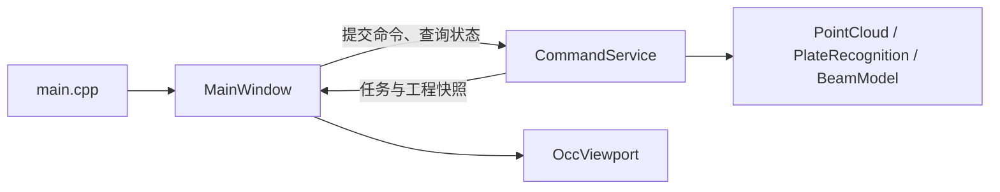

# ReverseModeling 开发指南

本项目是基于 C++20、Qt Widgets 和 OCCT 的点云辅助逆向建模桌面应用。主要流程是：导入 PCD 点云，识别可观测板件的位置和厚度，生成单侧模型，再进行偏差计算和 STEP 导出。底板按两侧板识别厚度的最大值估算，缺少侧板依据时保留底部观测面；桌面重建入口固定使用点云板件识别。

工程包含两个可执行程序：

| 程序 | 职责 | CMake 入口 |
|---|---|---|
| `ReverseModeler` | 桌面交互、点云与模型显示、建模操作 | [主程序 CMakeLists.txt](CMakeLists.txt) |
| `ReverseServiceTests` | 使用 Google Test 检查几何与命令服务 | [测试程序 CMakeLists.txt](../tests/CMakeLists.txt) |

开发时打开仓库根目录的 [CMakeLists.txt](../CMakeLists.txt)。两个程序直接编译同一份业务源码，工程内部不生成独立业务库。

## 目录与代码入口

```text
PointCloudReverseModeling/
├── CMakeLists.txt               # 总入口，加载两个子项目
├── CMakePresets.json            # 全仓库唯一的构建预设
├── cmake/
│   ├── common.cmake             # C++ 标准、编译选项与输出目录
│   └── Dependencies.cmake       # 全部第三方库查找与公共链接库
├── ReverseModeling/
│   ├── CMakeLists.txt           # 主程序文件清单、头文件搜索目录和链接库
│   ├── ReverseModeling.cmake    # 汇总 core、geometry、commands 的公共文件
│   ├── main.cpp                # QApplication 与 MainWindow 入口
│   ├── core/                   # 点云、参数、网格和结果的数据类型
│   ├── geometry/               # 点云读取、PCA、建模、STEP 与偏差算法
│   ├── commands/               # 异步命令、工程状态与 JSON
│   ├── workbench/              # Qt 窗口与 OCCT 视口
│   └── examples/               # 参数格式示例
└── tests/
    ├── CMakeLists.txt           # 测试程序文件清单、头文件搜索目录和链接库
    ├── tests.cmake             # 测试文件清单
    └── service_tests.cpp        # Google Test 用例
```

建议按以下顺序阅读：

| 文件 | 重点 |
|---|---|
| [main.cpp](main.cpp) | 应用启动与主窗口创建 |
| [MainWindow.cpp](workbench/MainWindow.cpp) | 用户操作、参数面板、任务轮询和界面刷新 |
| [WorkbenchActions.cpp](workbench/WorkbenchActions.cpp) / [RibbonBuilder.cpp](workbench/RibbonBuilder.cpp) | 共用动作、能力标记、Ribbon 与视图工具条 |
| [DockWorkspace.cpp](workbench/DockWorkspace.cpp) | ADS 工具窗口、窗口菜单、布局保存与恢复 |
| [ModelInspector.cpp](workbench/ModelInspector.cpp) | 部件模型树、只读属性、稳定 ID 与三维选择联动 |
| [OccPartMesh.h](workbench/OccPartMesh.h) | 为部件网格提供按真实三角面命中的整件选择实体 |
| [RecentFilesMenu.cpp](workbench/RecentFilesMenu.cpp) | 最近成功导入的点云/模型路径、排序去重、持久保存与清空记录 |
| [WorkbenchPanels.cpp](workbench/WorkbenchPanels.cpp) | H 型钢/T 排模板入口、各类型参数及后续操作表单 |
| [WorkbenchTheme.cpp](workbench/WorkbenchTheme.cpp) | 深色主题、自有图标与高 DPI 图标尺寸 |
| [CommandService.h](commands/CommandService.h) / [CommandService.cpp](commands/CommandService.cpp) | 命令入口、任务状态、工程快照和版本控制 |
| [Types.h](core/Types.h) | `CloudData`、`BeamParameters`、`MeshData` 等公共数据契约 |
| [PointCloud.cpp](geometry/PointCloud.cpp) | PCD 读取、单位转换、有效点过滤和 PCA 初值 |
| [PointCloudExport.cpp](geometry/PointCloudExport.cpp) | 全量点云 PCD 写出、回读核对与不覆盖提交 |
| [ModelImport.cpp](geometry/ModelImport.cpp) | STEP/STP、CWRM v2 BRep 解码和导入 |
| [ModelExchange.cpp](geometry/ModelExchange.cpp) | CWRM v2 写出回读、模型表面采样与独立文件转换 |
| [BeamModel.cpp](geometry/BeamModel.cpp) | 板件建模、网格生成、STEP 导出与回读、偏差计算 |
| [PlateRecognition.cpp](geometry/PlateRecognition.cpp) | 从点云顶边条带识别厚度和站位，按两侧板最大值估算底板，保留缺测观测面 |
| [OccViewport.cpp](workbench/OccViewport.cpp) | 点云与三角网格的 OCCT 显示适配 |
| [ModelDisplayData.cpp](workbench/ModelDisplayData.cpp) / [OccModelPresentation.cpp](workbench/OccModelPresentation.cpp) | 按部件归属拆分网格、灰色实体与拓扑轮廓、模型板厚标注及屏幕避让 |
| [ModelLabelVisibility.cpp](workbench/ModelLabelVisibility.cpp) | 板件主表面朝向及模型网格遮挡判断，避免显示背侧板厚 |
| [PointCloudDisplayData.cpp](workbench/PointCloudDisplayData.cpp) | 中立点云显示采样与紫青高度渐变 |

## 业务调用流程



1. **导入文件**：STEP/STP 和 CWRM 经 `loadCadModel()` 直接创建模型，替换当前点云/模型并清空编辑历史；PCD 路径为：`MainWindow` 调用 `submitImport()`，后台依次执行 `loadPointCloud()`、`estimateBeam()` 和 `recognizePlates()`，得到点云、初始方向及逐板识别结果；识别失败保留点云与原因，不填经验板厚。
2. **生成模型**：默认通过 `submitRecognizedReconstruct()` 调用 `buildRecognizedPlates()`，构建各板件的识别尺寸，底板按两侧板厚最大值向观测面背侧生成实体，宽度夹在翼板内侧面之间，翼板下沿延伸到其底面；缺少任一侧板可靠识别值时保留底部观测面。镜像默认关闭，开启后明确记录镜像部件的来源。显式手动模式继续通过 `submitReconstruct()` / `buildBeam()` 建模。
3. **更新显示**：界面通过定时器轮询 `task()`，读取 `project()` 返回的工程快照，再更新参数、日志和 `OccViewport`。
4. **导出与偏差**：`submitExportCloud()` 写出当前全量点云，`submitExport()` 执行 STEP 写出及独立回读检查；`submitDeviation()` 计算点到当前模型板件表面的距离。

服务与几何接口见 [CommandService.h](commands/CommandService.h) 和 [Geometry.h](geometry/Geometry.h)。[Json.h](commands/Json.h) 提供任务、工程摘要的序列化和参数解析，当前 `schemaVersion` 为 1，摘要不携带点云或网格大数组。

### 数据与线程约定

- 内部尺寸统一为 **mm**；PCD 的界面、命令及 Python 导入统一固定使用 mm；`cloud.import` 只接收路径，不再提供 `--unit`。独立几何层仍保留单位换算接口；STEP 读取文件单位并转换到 mm，CWRM 按 mm。`CloudData` 中的点使用局部坐标，项目坐标为 `position + originMm`；`MeshData` 顶点使用项目坐标。
- `CommandService` 使用一个常驻工作线程和有界 FIFO，最多排队 64 条请求；各命令顺序执行。按钮、命令窗口和 Python 经过同一参数检测与分发入口，QWidget 和 AIS 对象由 GUI 线程操作。
- 重建、导出和偏差命令携带 `expectedRevision`，旧版本请求会被拒绝。导入或重建成功后更新工程版本；失败保留原有结果。
- 取消通过 `std::stop_token` 协作完成。关闭窗口先调用 `requestShutdown()`，GUI 定时查询 `shutdownComplete()`，解释器在工作线程清理完毕后才关闭窗口；单次 OCCT 内核调用可能需要等待其返回，等待期间 GUI 继续响应。
- 当前工程状态保存在内存，任务与资产 ID 在本次服务生命周期内有效。

## 桌面工作台

`MainWindow` 继承 `SARibbonMainWindow`，使用 `UseRibbonMenuBar | UseNativeFrame` 保留原生系统标题栏。SARibbon 组织顶部功能区，单层 ADS 管理固定中央视图和六类工具窗口。视图容器、日志及工程摘要由 `MainWindow` 装配，视图工具条由 `RibbonBuilder` 创建，重建参数与操作表单集中在 `WorkbenchPanels`；各文件入口见上方代码表。

布局与交互参考 CypModeler 截图及灵控平台 `D:/projectWQZ/ProjectManager/project/LingkongPlatformLauncher/src/LingkongPlatformLauncher/Launcher/MainWindow.cpp`。主要借鉴其 Ribbon 分组、组件尺寸和 OCCT 容器用法；本工程使用独立的主题与单层 Dock 管理，不引入灵控的插件系统、嵌套 QDockWidget 或构建包装。截图只提供 UI 参考，不能据此认定对应算法或文件格式已经实现。

### 工具窗口与布局生命周期

| 窗口 | 稳定 `objectName` | 初始停靠位置 | 当前内容 |
|---|---|---|---|
| 模型树 | `dock.modelTree` | 右侧自动隐藏 | 上方为工程、点云及模型树；下方为所选对象的只读属性，共用窗口和标签 |
| 命令窗口 | `dock.commands` | 底部自动隐藏 | 命令输入、运行日志/警告/结果、复制所选、清空输出和宏录制/回放 |
| 重建参数 | `dock.reconstruction` | 右侧自动隐藏 | 逐板识别结果及独立手动参数模式 |
| 操作面板 | `dock.operation` | 右侧自动隐藏 | 移动、旋转、基准面、孔洞等操作表单 |
| 任务信息 | `dock.tasks` | 底部自动隐藏；固定时与命令窗口同组 | 当前任务名称、状态、阶段和进度，不维护历史任务列表 |

中央三维视图使用 `dock.viewport`，不可关闭、移动、浮动或自动隐藏，不列入窗口菜单。初始工具窗口只在右侧和底部，均默认自动隐藏；右侧展开宽度约 340 像素。模型树与属性表通过竖向 `QSplitter` 合并为 `panel.modelInspector`，树在上、属性在下，初始比例约 2:1；不再注册 `dock.properties`。工具窗口沿用主窗口深蓝配色和约 22 像素窄标题栏，内容由 ADS 管理；工作区外层使用独立的 `QTabBar`，右侧竖排、底部横排，标签始终保留完整顺序。ADS 原生侧栏不占布局空间，工具 Dock 使用 `NoTab` 避免重复标签；标题栏只保留图钉。窗口只有自动隐藏/固定两种状态，禁用关闭、浮动、拖离及原生右键模式菜单。图钉始终使用“自动隐藏 / 固定窗口”提示；点击边缘标签、Ribbon 或窗口菜单后直接固定到注册侧；同侧已有窗口时共用同一个内容区，每侧只显示一个工具窗口，侧边和底部可同时显示。外层标签不随固定或收起移动、删除；点击当前标签也能重新展开收起的内容，菜单和 Ribbon 同步更新标签选中状态。移开鼠标、点击视图或其他窗口不会自动收起，不再悬停弹出。图钉手动收起整组并回到注册侧栏。窗口菜单重复点击不会关闭面板。

手动收起、切换 Dock 标签及切换图钉不取消正在进行的工具编辑；切换工具页、取消或退出工具仍结束该工具编辑。Qt 标签栏点击后固定到 ADS 原生布局，不使用覆盖式弹窗或根分隔器补偿边距。三维视图随固定窗口自然缩小，手动收起后恢复；底部只占中央视图下方，侧栏保持全高。记录每侧收起前尺寸，再展开时恢复。恢复已有布局时将同侧分离的固定区域归并为一个标签组。面板保留原实例和内容。Ribbon“重建参数”和窗口菜单指向同一个 Dock；“全部自动隐藏”将窗口收回侧栏；“恢复默认布局”恢复右侧及底部自动隐藏，不清空点云、模型、日志或参数。

布局在 `QSettings` 的 `ui/layout/v6` 组保存主窗 `geometry` 和 ADS `docks` 状态，ADS 布局版本为 6；首次使用新布局仅继承 v5 的主窗大小与位置（缺失时回退 v4），不沿用允许关闭/浮动的旧停靠状态。启动顺序为：设置 ADS 全局配置 → 创建中央 Dock 并调用 `setCentralWidget()` → 注册全部工具 Dock → 捕获默认布局 → 恢复用户布局。恢复失败回退默认快照，并检查主窗位置是否仍在可用屏幕范围内。正常关闭流程被接受后才保存布局；有后台任务时先请求取消并等待安全退出。窗口集合或保存格式发生不兼容变化时同步升级配置组与布局版本。

首次进入 v6 使用新的默认排列；正常关闭后继续记忆固定/自动隐藏状态和窗口尺寸。“恢复默认布局”按当前窗口尺寸重新分配区域，不清空业务内容。原 `dock.log` 不再注册，其功能已合并到命令窗口。

### 动作、参数与后续接入

“打开 → 最近打开文件”由 `RecentFilesMenu` 管理，最近 10 条路径保存在 `QSettings` 的 `files/recentPointClouds` 中。仅在导入任务成功后加入或前移记录；菜单重开与普通打开共用 `MainWindow::importCloud(path)`，按扩展名分派导入，忙时不可提交。完整路径用于区分同名文件，Windows 路径去重忽略大小写；失效文件保留记录但禁用，清空不触及源文件。

`WorkbenchActions` 统一创建 QAction、稳定名称、快捷键和能力标记，供 Ribbon、菜单及快捷键共用。`MainWindow` 根据项目快照、任务和参数修改状态更新可用性：已有业务正常提交服务；表单预览动作只打开输入界面，执行按钮禁用；尚未接入的命令整体禁用并说明原因。忙时仍可查看日志和切换工具窗口。

工具图标和菜单项的悬停帮助由 `WorkbenchActionHelp` 统一维护，包含作用、操作方法、使用条件和已有快捷键；置灰时也可查看说明。撤销/重做的当前操作、基准面禁用原因和导出目录通过 `setActionHelpContext` 追加，状态刷新不覆盖固定帮助。新增动作时同步补充说明，不将未接入功能描述为已实现。

| 功能区域 | 已有能力与预留入口 |
|---|---|
| 文件 | 导入 PCD、STEP/STP、CWRM；打开菜单保留“打开”和“最近打开文件”；导出当前点云 PCD、模型 STEP/CWRM、模型表面采样 PCD |
| 编辑与点云 | 框选、加选/减选、截取保留选区、删除选区、点云/模型统一撤销、重做及导入基线重置可用；已删除不适用于当前 PCD 重建流程的对齐、拼接去重、2D 识别精度占位菜单 |
| 重建 | 参数、开始重建、停止重建与局部重建连接现有服务；局部重建只替换选中部件 |
| 模型修改 | 板厚/轮廓调整、设为槽钢/角钢、外扩贴板/下底板支持预览和真实建模；过焊孔/底边孔支持底边定位、预览及真实切除；圆角/倒角支持边线处理、异步预览和应用；体模式下可移动、旋转和删除选中部件；钢结构分组提供镜像补全 |
| 工具 | 测量支持可见模型/点云两点距离及 XYZ 分量；基准面支持三点/特征面定义、预览确认与正视；计算偏差使用现有服务 |
| 视图工具条 | 点云/模型显隐、实体/线框切换、高度渐变、可见侧板厚及方向立方体可用；点云框选可拖边缩放、拖内部移动；底板面/基准面点云剖视可用，右上角在上视图（未重建）、底板面（已重建）及剖视面（已启用剖视）间切换 |

模型选择：点/线/面/体分别拾取真实 BRep 顶点、拓扑边、完整面和部件；视口高亮当前对象，属性显示类型及部件内编号，模型树定位所属部件。顶点和边不使用显示网格细分线或包围盒。被模型面遮挡的对象不拾取。生成或导入模型后自动切到“可选：体”，左键单击部件高亮，并选中模型树对应节点、显示属性；点击树节点会显示模型并高亮对应部件。空白单击或 Esc 清空选择，隐藏模型或替换资产时清除旧选择。模型树区分点云、重建模型、STEP/CWRM 模型；按稳定部件 ID 关联，不依赖树行号或网格顺序。属性只读，板厚以一位小数显示，厚度依据说明来源，不追加“估算”提示；STEP/CWRM 等厚实体从两个平行主面计算板厚，标签可双击编辑；无法可靠识别的部件保持未识别。包围盒来自该部件显示网格的项目坐标，沿世界坐标轴排列，尺寸不能当作局部板厚。

“可选：点 / 线 / 面 / 体”均支持批量选择：普通点击替换，Shift 或 Ctrl 点击追加，再点已选对象取消；工具条“加选”累加、“减选”移出。子对象通过部件 ID、类型和编号区分，同一部件的多条边或多个面分别高亮；属性框显示选中数量与对象列表。切换类型、普通点击空白或 Esc 清空选择，Shift 点击空白保留选择。模型树支持 Ctrl / Shift 多选，与视口高亮和多选属性同步。选中至少一个部件时“删除模型”可用；点/线/面模式、测量及基准面拾取期间禁用。

点击模型树的部件行时，视图纳入整体模型，保留所选部件与工件的位置关系；当前方向清晰时保留方向，受其他部件遮挡或侧立难以看清时，比较有限观察方向并选取可见投影面积更大的方向。整体画面中尺寸不足 40 像素的小目标显示定位圈和名称，放大后恢复普通选择高亮；定位标记不参与拾取、模型尺寸和导出，取消选择后消失。重复点击同一部件可再次定位；取消选择、程序同步模型树以及直接在三维视图选取时不改变相机。取景仅改变显示，不产生模型历史。

删除通过后台 `model.delete --parts '["imported-part-1","imported-part-3"]'` 执行，命令窗口回显且可录制重放，不依赖当前选区。模型树、板厚标注、测量/拾取拓扑和 STEP 导出同步移除部件；剩余部件 ID、颜色、坐标及板厚保持不变。不存在的 ID 整条拒绝，全部删除后清空模型并禁用导出，保留点云和源文件。删除进入统一工程历史，`project.undo/redo` 可恢复或再次删除同一组部件；重置可恢复完整导入模型。

`ModelInspector` 仅在模型资产变化时重建部件树和属性缓存；选区、导出状态变化不重建树。`OccPartMesh` 扩展 `AIS_Triangulation` 的整件选择实体，按三角面命中而非包围盒；`OccModelPresentation` 显式注册并激活选择模式，标注和引线不参与选择。方向立方体的点击优先处理。选择与高亮只属于 GUI 状态，不改变服务模型或导出几何。

点云编辑：切换到“可选：点”后左键拖动矩形框选，选择工具条中的“选择 / 新增选择 / 移除选择”切换替换、加选和减选。橙色矩形表示框选范围，蓝色表示选中点；右键单击打开“截取点云 / 删除点云”菜单，右键拖动仍旋转视图。“截取点云”只保留选中点，“删除点云”移除选中点；未选点或点云隐藏时禁用。单击空白（替换模式）或 Esc 清空选区。框选贯穿当前相机视锥深度，包括遮挡点，作用于完整点云，不只处理最多 20 万个显示点。

已画出的橙色框可继续调整：左键拖动四边改变单个方向的尺寸，拖动四角同时改变宽高，拖动框内部整体移动。悬停时显示对应方向的光标；单击框内保留选区，在框外拖动新建框。拖动过程中只更新矩形，松开后后台重新计算完整点云的选中结果；加选/减选调整最近一次框的贡献，保留此前选区。框限制在视口内，缩放不越过对边；旋转、平移、缩放视图、改变拾取类型或选择方式会清除屏幕框，Esc 同时清空选中点。

`SelectionRectangle` 管理物理像素下的边角命中与拖动，命中容差和最小尺寸随 DPI 缩放。`CloudSelectionRect` 保存局部毫米坐标到相机裁剪空间的矩阵与矩形；`geometry/CloudEditing` 处理投影、增减索引和过滤，不访问 Qt / AIS。调整已有框通过 `cloud.select --edit-last true` 替换选区配方的最后一个矩形，保持该步原来的选择方式，录制回放及后续截取/删除使用更新后的配方。过滤保留原始 `sourceIndex`、强度、单位和显示原点，重算当前包围盒；原始文件点数与当前有效点数分开统计。`PointCloudDisplayData::pointIndex` 将显示采样映射到当前完整点云选区，选择本身不改变识别和模型。

截取或删除通过 `CommandService` 后台执行，成功时原子更新点云、重算 PCA / 板件识别，保留旧模型及部件点云关联，清除偏差与导出状态；识别失败保留编辑后的点云并给出提示。删除全部点允许得到空点云，不能继续重建。失败或取消保留操作前状态。编辑不写源 PCD 文件；全选后截取不改变数据或模型。

撤销/重做统一覆盖点云截取/删除、模型重建/参数建模、部件删除及已确认基准面，最多保留 10 步；恢复点云、识别、真实几何、稳定部件 ID 和已提交参数，清空临时选区、测量及旧偏差/导出缓存。重置恢复本次导入的完整点云或 STEP/CWRM 模型，重置也可撤销；新编辑清空重做，重新成功导入建立新基线。`ProjectHistory` 在产品层管理共享不可变内容，输出目录、磁盘文件和录制状态不回滚。`ReplayJournal` 独立保留当前会话必要命令过程，中途开始录制自动补写；撤销、重做、重置各追加一条 `project.*` 命令，不删改脚本旧行。Delete、Ctrl+Z、Ctrl+Y 仅在视图区有焦点时执行点云删除、撤销和重做，不影响参数输入。编辑后相机位置保持不变，可双击空白处重新居中；已移除“适合视图”工具条按钮及 F 快捷键。

“停止重建”仅取消重建任务；其他任务使用状态栏的“取消任务”，命令窗口使用“中断”或 Ctrl+C。命令窗口统一以 `rm>` 输入和回显原生命令；录制文件沿用 `.py` 扩展名，建模命令直接写命令名及参数，无包装和模块版本。命令窗口和脚本也支持 `print()`、变量、import、循环及 input；多行输入以空行结束。回放逐条回显实际执行的建模命令，未捕获错误显示行号并停止，Python 和业务执行始终在同一工作线程。新增 UI 命令通过 `CommandService` 提交，在实际执行时检查 `expectedRevision`；Qt、SARibbon、ADS 类型不进入 `core`、`geometry` 或业务服务契约。命令定义、手写业务、Python 适配和使用方法见[命令框架与 Python 使用指南](../docs/命令框架与Python使用指南.md)。

重建参数面板使用点云板件识别，支持 H 型钢及 T 排模板。H 型钢显示端部突出容差、识别腹板孔、忽略小孔半径三项；T 排显示三种预设、地面/台架及对应参数（见下文）；不再显示建模方式选择、手动尺寸/站位输入和应用按钮，也不显示文件路径、点数、显示原点、板件识别表格、模型摘要与额外说明文字。板件厚度与依据在模型树/属性中查看，导入和重建过程信息在命令窗口查看。导入有有效坐标框架的点云后允许重建；T 排按当前参数独立识别，失败报告原因，不回退到手动尺寸建模。

“端部突出容差”接入 `PlateBuildOptions`，默认 30 mm，0 关闭；只收齐沿梁长方向的小突出，超过阈值的长度保留并告警。镜像默认关闭，显式开启时沿腹板中面（未定厚时为观测面）补建并标识镜像来源。选项变化后需重新重建，完成前禁用 STEP 导出及偏差计算。“恢复默认参数”重置镜像、端部容差及腹板孔选项；撤销/重做、脚本建模和模型恢复时读取已提交的识别选项。原 `HBeamTemplateFields` 中 26 项未接入参数已从产品移除，不再让用户设置通用场景的算法开关。

操作面板共用一个 Dock，在内部切换表单。“模型调整”页顶部提供固定下拉框，与 Ribbon 菜单共用动作列表和使能状态，列出修改板厚、外扩轮廓、设为槽钢、设为角钢、外扩贴板、下底板、交叉板优化和镜像补全；“交叉板优化”和“镜像补全”归在“钢结构”分组下，分组标题不作为可执行选项。切换会取消未应用预览并同步拾取模式，只有应用才提交并录制命令。移动、旋转支持真实实体变换及预览，采用“确定提交、取消放弃”；添加孔支持等厚实体的过焊孔和底边孔，先预览再应用；其他待接入表单仍禁用几何执行。取消或切换操作会清理对应草稿，不让输入变化直接修改正式模型。

测量独立于操作表单：`PointMeasurement` 管理两点状态并计算毫米距离，`OccViewport` 通过 OCCT 选择器的空间索引拾取可见三角面/显示采样点，`OccMeasurementPresentation` 绘制不可选择且不参与适合视图包围盒的端点、距离线和结果卡片。XYZ 为工程轴的绝对坐标差；显示原点平移不影响结果。`MeasurementSnap` 缓存真实拓扑顶点的屏幕投影，在 16 个逻辑像素范围内按距离和可见性捕获；橙色端点表示已吸附，普通命中为白色。缩放、旋转和 DPI 变化会更新投影，遮挡通过 OCCT 射线查询排除；未捕获时回退到面/点云命中。第二点支持悬停预览，完成后第三次点击重开；Esc、右键“退出测量”及测量按钮均可退出。计算与少量标注刷新在视图线程执行，不遍历完整原始点云；不修改工程数据、不进入录制脚本。曲面距离以显示三角面交点为准，非 CAD 精确曲面测量。

### 原生视口、主题与依赖

`OccViewport` 通过 `ForceNoScrollArea` 放入固定中央 Dock，普通 QWidget 工具条与原生视口上下布局；下拉菜单使用独立弹窗，不在原生绘制区上叠加透明输入层。保留已有 `WinIdChange` 和 resize 处理。原生 OCCT 视口启用最高 8 倍 MSAA 抗锯齿，按显卡能力降到 4 倍、2 倍或关闭，平滑实体轮廓、拓扑边和选择高亮；不修改模型几何或导出数据。视图导航参考 CamAssemblyWelding 的 `AIS_ViewCube`：右上角固定锚点随设备像素比缩放，不计入工件包围盒，独立检测立方体面/棱/角；Qt 定时器驱动相机动画并同步板厚标签遮挡，手动导航会中断动画。`BottomView` 动作由 `positioningView` 和 `positioningPlane` 统一解析：剖视开启时优先使用所选剖视面；未重建模型时使用工程 Z 轴上视图，不受导入/导出文件、点云识别或自定义基准面的影响；已有本地重建模型时使用其底板面。空工程与单纯导入的 STEP/CWRM 模型也使用上视图。底板面/剖视面不可用时禁用对应定位，不回退到自定义基准面。点击定位保持缩放；初始相机为上视图，导入与重建完成后按对应默认方向居中。不变换点云或模型坐标。参数表单内部可使用 `QScrollArea`，工具 Dock 从内容最小尺寸获取约束；修改布局时关注分隔条、浮动面板及窄窗口下的内容裁切和鼠标坐标，不无差别设置 `WA_NativeWindow`。

模型显示使用 `MeshData::trianglePartIndices` 和 `partIds` 拆分部件，不依赖三角形连续排列。`ModelDisplayData` 将网格与同次建模的 `ModelSummary` 转成中立显示数据，板厚优先读取模型快照中的 `thicknessOverrides` 手动编辑记录；未编辑部件读取逐板识别记录；手动模型读取手动参数，不能覆盖识别模型的未识别状态；底板的 `inferred_side_plate_max` 来源传递为 `thicknessEstimated`，三维标签统一显示毫米厚度，属性/JSON 保留该来源和未取整的厚度；未选部件统一为浅灰色哑光实体，使用深色真实拓扑轮廓区分板件；选中为浅青填充和蓝色轮廓，悬停为更淡的灰青色，选中部件的板厚标签使用橙底白字；未知角色不猜测板厚。`OccModelPresentation` 为各部件创建独立 AIS 网格，通过自有 `Prs3d_ShadingAspect` 设置不透明配色。每块板件取两个主表面候选锚点，`ModelLabelVisibility` 按相机方向及视线与模型网格的交点筛选可见侧；背面、掠视或被遮挡的标签不参与屏幕避让。标签和引线在 OCCT 内绘制，保持屏幕字号且不参与 FitAll 包围盒。重建或重新导入时替换原呈现，隐藏实体同步隐藏其标注。配色及标签属于显示层，不改变业务几何、STEP 数据或用户参数。

`PointCloudDisplayData` 在最多 20 万个显示采样点上计算沿 PCA 短轴的高度，使用 2% / 98% 分位数映射紫青色域；退化高度使用中间紫色。`OccViewport` 通过 `Graphic3d_ArrayOfPoints` 的逐点颜色绘制，默认开启“高度渐变”，纯色模式使用青色。只在更新点云、选区或切换模式时重建显示数组，旋转、平移和缩放不重算配色。桌面选择 PCD 后固定按 mm 提交导入，不再显示单位确认或切换弹窗。

主题入口为 [WorkbenchTheme.cpp](workbench/WorkbenchTheme.cpp) 和 [workbench.qss](workbench/resources/workbench.qss)，资源通过 `.qrc` 管理。当前采用深蓝黑背景、青蓝强调色和浅色文字：视口背景 `#081521`、面板背景 `#0B202A`、强调色 `#1EA7D8`、主文字 `#DCE4EA`。图标由 QPainter 绘制多个尺寸及禁用状态，不裁剪参考软件图标，也不额外依赖 QtSvg。主窗口与 ADS 使用统一 QSS，避免库的默认主题覆盖；Ribbon 中文字体、分组标题高度和图标尺寸需协同调整，布局尺寸使用逻辑像素。

应用图标独立于工具栏图标：自有 [ReverseModeler.svg](workbench/resources/app/ReverseModeler.svg) 用紫色采样点过渡到青蓝实体表达点云逆向建模。生成的 ICO 包含 16、20、24、32、40、48、64、128、256 像素九个尺寸，Qt 全局窗口图标与 Windows EXE 的 RC 资源共用此文件；Windows 启动前设置稳定的进程 AppUserModelID，主窗口首次显示前同时指定窗口 AppUserModelID、任务栏图标资源、显示名与重新启动命令，避免只更新标题栏而遗漏任务栏分组图标。路径从当前运行的 EXE 动态取得，不写死开发目录；窗口销毁前清除所设置的 Shell 属性。CMake 编译、安装和打包自动带上嵌入图标，运行时不读取外部图片。修改 SVG 后，在仓库根目录执行 `python pythonProject/generate_app_icon.py --inkscape "D:/app/Inkscape/bin/inkscape.com"` 更新 ICO 和预览 PNG。Inkscape 仅用于维护美术资源，不属于正常构建或运行依赖。

[Dependencies.cmake](../cmake/Dependencies.cmake) 统一查找 `SARibbonBar 2.8.0` 和 `qtadvanceddocking-qt6 4.5.0`。[主程序 CMakeLists.txt](CMakeLists.txt) 仅为 `ReverseModeler` 链接 `SARibbonBar::SARibbonBar` 与 `ads::qtadvanceddocking-qt6`，并启用 `AUTOMOC`/`AUTORCC`；两个 UI 库不加入 `RM_COMMON_LIBRARIES` 或服务测试目标。继续通过安装前缀消费匹配的 SDK，不引入第三方源码构建。运行时 DLL、Qt 插件和 OCCT 资源要求见[根 README](../README.md#构建与运行)，正式分发需保留所用库的许可证文件。

## 修改代码与添加文件

头文件与源文件放在同一功能目录，各目录的同名 `.cmake` 分别使用 `RM_SOURCES` 和 `RM_HEARDERS` 汇总文件。**每个文件单独一条追加语句**：

```cmake
list(APPEND RM_SOURCES "${CMAKE_CURRENT_LIST_DIR}/Example.cpp")
list(APPEND RM_HEARDERS "${CMAKE_CURRENT_LIST_DIR}/Example.h")
```

`RM_HEARDERS` 是当前工程约定的变量名称。两个程序的 `CMakeLists.txt` 分别初始化文件清单并创建目标；公共文件由 [ReverseModeling.cmake](ReverseModeling.cmake) 汇总。主程序专用的 `main.cpp`、`workbench` 和测试专用的 `tests.cmake`，分别在对应程序的 `CMakeLists.txt` 中加入。

| 修改内容 | 维护位置 |
|---|---|
| 点云或几何算法 | `geometry/` 及 `geometry.cmake` |
| 命令、任务或工程状态 | `commands/CommandService.*`；公共数据类型放在 `core/Types.h` |
| 板件厚度及站位识别 | `geometry/PlateRecognition.cpp` |
| 界面与显示 | `workbench/` 及 `workbench.cmake` |
| 新增公共模块 | 新建同名 `.cmake`，由 `ReverseModeling.cmake` 包含 |
| 新增第三方依赖 | 在 `Dependencies.cmake` 查找；公共链接库加入 `RM_COMMON_LIBRARIES`，程序专用库在对应 `CMakeLists.txt` 链接 |
| 新增测试 | `tests/service_tests.cpp`；新增测试文件时逐个加入 `tests/tests.cmake` |

## 单元测试

测试程序位于独立的 [tests/](../tests/) 目录，直接编译公共服务实现。现有用例覆盖单位、点云属性、逐板识别、缺测厚度、镜像、几何与偏差、取消及异常输入，以及服务版本控制、失败保留和 STEP/JSON 往返。配置、构建与运行方式见 [测试程序说明](../tests/README.md)；工程整体环境与运行说明见 [根 README](../README.md)。

## 当前能力边界

- 桌面 UI 框架及现有业务入口已接入；当前模板包括 H 型钢与 T 排；点/线/面/体选择和只读属性已接入，属性编辑、新几何操作、实体剖切及其他工件模板算法仍待实现。各入口状态见[桌面工作台](#桌面工作台)。布局记忆不保存点云、模型和参数。
- 支持 PCD 的 ASCII、binary、binary_compressed 格式。内存中保留 XYZ、intensity、源点索引、字段名称和无效点计数，其他字段保留在原文件中。
- PCA 与底部观测面拟合提供方向；当前从单侧正交板件的连续顶边条带识别各侧板、肋板的厚度和实际站位。沿条带分段计算横向 2%–98% 宽度，以中位数汇总并记录截面四分位差。缺少连续支持或厚度不稳定时不补板件，不把投影包围厚度当成测量结果。底板尚无可靠双面测厚：两侧板均通过识别时，采用未取整厚度的最大值，并记录 `inferred_side_plate_max`，这是建模估算而非底板实测值。观测面作为底板上表面，向背侧加厚；底板横向边界使用两翼板内侧面，翼板下沿贴合底板底面，肋板底面仍接底板上表面。各翼板的纵向端部独立识别；建模时仅在容差内将底板端部突出收齐到翼板共同范围，保留超阈值突出与原始识别记录。镜像时两半翼板在底板中面分界，避免底板厚度范围内出现重复实体。任一侧板证据不足时保留底部观测面。自动双面板厚、任意曲面和局部孔洞识别仍未实现。
- 默认模型由识别的单侧板件和最大值估算的底板组成，依据不足时底板为观测面；使用“模型调整 → 全部镜像补全”补建另一侧。偏差计算针对有限矩形板件表面，包含端面与边界；任意 CAD 模型的通用距离计算尚未实现。
- 当前点云导出为 binary PCD，使用 float64 XYZ 项目坐标（mm），存在 intensity 时一起保存；不包含未保留的 RGB 等字段或内部源索引。`cloud.export` 仅导出当前全量点云，空点云或只有模型时禁用。单独的 `model.export_pcd` 按模型三角表面采样，只输出 XYZ，最多五百万点；曲面精度受三角网格离散影响，不替换工程点云。
- 模型导入保留实体/独立曲面及位置，展开装配实例并按部件使用本程序配色；不保留装配树、原名称/颜色、线/点对象或来源软件的编辑历史。导入模型自动检测等厚实体板厚，不参与矩形板件偏差算法。CWRM 当前支持 v2、`shape_type=brep`：Base64 + AES-128-ECB 零填充，解码后读取头部及 OCCT BRep；编码/版本不匹配或文件损坏时拒绝并保留当前工程。通过 OpenSSL 3 Crypto 处理，不依赖安装柏楚程序。
- PCD、STEP、CWRM 均支持 Windows 中文目录/文件名；临时文件检查完成才提交，取消或失败不覆盖原文件。CWRM 导出保存 v2 BRep 几何，回读核对数量、体积及位置，不保存本程序的命令历史、点云或重建参数。
- `file.convert` 独立读取 STEP/STP 或 CWRM，可写出 STEP/STP、CWRM 或模型采样 PCD，不改变当前工程和撤销历史。PCD 输入一律拒绝，包含 PCD 转 PCD；正常导入点云、手动重建及各自导出仍可使用。新增导出及转换可录制，外部文件写入不会随工程撤销，也不在中途开始录制时补写。用例见[文件导入导出与格式转换](../docs/文件导入导出与格式转换.md)。
- STEP 导出检查实体有效性，并独立回读核对实体数、独立观测面数、体积和包围尺寸等结果；目标文件已存在时拒绝覆盖。
- 尚未提供跨进程工程持久化、自动轮廓与孔洞恢复或 Web 服务。

手动参数格式示例见 [beam-parameters.json](examples/beam-parameters.json)，其中数字仅演示格式，不作为识别默认值。桌面重建仅使用点云识别，不提供手动尺寸编辑或该 JSON 文件的导入入口。研究背景与后续方案见 [参考资料入口](../reference/README.md)，Python 扩展约定见 [Python 脚本编码规范](../docs/Python脚本编码规范.md)。

### 基准面与点云剖视

“工具 → 基准面”在操作面板中提供两种方式：三点方式依次拾取点云或模型表面，靠近模型顶点时吸附；特征面方式拾取 STEP/CWRM 或重建模型的一个平面。选满后显示半透明预览及法线 N，点击“确定”提交；“反转法线”改变点序。重复点、共线点和曲面不会作为有效定义。取消、Esc、右键“退出基准面设置”或切换操作页丢弃草稿，保留已确认平面。

确认基准面后，可在操作面板点击“正视基准面”。视图工具栏“剖视”为分体按钮：主按钮仅开关剖视，点击右侧下三角才打开独立设置菜单；选择“底板面1”或“基准面”、修改毫米偏移及反向保留后立即应用。菜单打开时显示剖视面预览，关闭菜单保留裁剪。偏移沿原法线，反向只改变保留哪一侧。右上角在剖视启用时显示“剖视面”，点击正对所选剖视面；关闭时，尚未重建显示“上视图”，重建后显示“底板面”。上视图沿工程 Z 轴俯视、Y 轴朝上，不要求导入或导出文件；仅识别出底板不算已重建。三种定位均保持当前缩放；底板面/剖视面缺失时对应定位不可用。底板取本地模型的 web 板件（包含部件变换），无模型时取点云识别结果；不把任意 STEP/CWRM 面猜作底板。

剖视只过滤点云显示，**框选仍贯穿深度，重建和 PCD/STEP 导出仍使用完整数据**。新文件导入清除基准面和剖视；截取、重建保留基准面，所选剖视面丢失时自动关闭剖视。确认设置/清除基准面会关闭当前剖视并进入工程历史，可单独撤销/重做。

依据本机 CypModeler 的 `resources/webapp/chunk/main.js` 中 `SectionalFaceUtil`（`filterPntsByBaseFace` / `changeViewToBase`）和 `PCRView.js` 中 `SectionSettings` 的静态分析：三点/特征面提交的是视图参考平面，正视改变相机，剖视给点云添加裁剪平面，不旋转原始点云或修改板厚。参考软件还将它供手工拉伸建模使用；本工程的手工拉伸尚未接入，本次没有改变自动重建算法。

基准面及剖视使用统一命令服务，GUI 与命令窗口显示和录制一致，`.py` 脚本直接保存以下形式；坐标是毫米工程坐标（已加回显示原点），不是屏幕像素或局部坐标：

```text
project.set_reference_plane --points '[[0,0,0],[100,0,0],[0,100,0]]'
project.section --enabled true --plane reference --offset 10 --reverse false
project.section --enabled true --plane bottom --offset 0
project.section --enabled false
project.clear_reference_plane
```

`project.snapshot` 包含 `referencePlane` 和 `section`；各命令支持 `-h/--help`。业务状态位于 `ProjectSnapshot`，几何校验位于 `geometry/ReferencePlane`，UI 草稿和异步提交位于 `workbench/ReferencePlaneTool` 和 `workbench/SectionTool`，平面来源与定位规则集中在 `commands/SectionPlane`。特征面使用 OCCT 曲面类型标志与真实面编号，不用三角网格的局部平坦程度推断。

### 实体与线框显示

视图工具条的模型下拉菜单可选择“实体”或“线框”。选择后立即显示模型，主按钮文字和悬停提示同步变化；主按钮仍控制模型显隐。线框仅绘制真实 BRep 拓扑边，隐藏表面填充，透视查看后侧轮廓；不会显示三角网格内部的细分线。点/线/面/体拾取继续使用原有拓扑与选择实体，选中面/体在线框模式下只高亮边界。模式在模型重建及显隐切换时保留，不修改几何、重建参数或导出内容。

本机 CypModeler 静态参考：`PCRView.js` 的显示菜单调用 `toggleWireFrame` 并更新显示名称；`main.js` 的 `FaceDisplay.toggleWireFrame` 隐藏面、保留 `refEdges`，视图层同时恢复模型可见。工程以 `OccPartMesh` 的拓扑边呈现实现同一显示行为。

### 部件移动与旋转

“可选：体”下选择一个或多个部件，再点击“移动”或“旋转”。支持模型树 Ctrl/Shift 多选。移动使用项目 X/Y/Z 毫米位移；旋转使用项目坐标系单轴 X/Y/Z、公共旋转中心和有符号角度，单次范围 -180°～180°。从轴正向朝原点看，正角逆时针，负角顺时针。初始中心取所选部件整体包围盒中心，可修改为准确项目坐标。

输入数值或拖动彩色轴柄时，实体显示实时响应，青色轮廓和半透明几何保留原位置作对照。旋转只显示当前轴的圆环，不能任意自由转向；没有缩放操作。预览冻结所选目标，不改变工程几何、历史或脚本。取消、Esc、右键取消、切换面板或工程状态变化都会清除预览；确定后工作线程修改实际 BRep 并产生一个撤销步骤。模型树包围盒、拾取、测量、板厚标签及 STEP 导出使用变换后的结果；点云和已定义基准面保持项目坐标不动。

新增 `model.move --parts ... --offset ...` 和 `model.rotate --parts ... --axis ... --angle ... --center ...`，GUI、命令窗口及脚本共用参数检测和业务。确认后的完整命令包含稳定部件 ID、位移或轴/角度/中心，支持即时录制、中途录制补写及回放。无变化和非法请求不新增历史、不截断重做分支。

实现分工：`geometry/ModelTransform` 处理纯坐标数学，`BeamModel` 复制选中部件拓扑并变换，`ModelSummary::partTransforms` 保留累计项目变换；矩形板件偏差使用每个部件的变换框架。`workbench/ModelTransformTool` 管理编辑草稿，`OccTransformPreview` 管理 AIS 原位置参照和受约束的手柄。参考本机 CypModeler 的 `RotateByCenterStrategyImpl` / `CmdModelRotate` 的中心旋转与预览提交分离方式；没有复制其界面资源。

### 圆角与倒角

点击“圆角/倒角”自动进入线选择。普通点击一条边，按住 Shift 追加同一实体或其他部件的边（Shift 再次点击已选边取消），输入毫米数值后按回车，或点击“预览”。操作针对等厚板件的平面轮廓，保持板厚不变：选择直线轮廓边处理它两端尚未光顺的板角；选择贯穿板厚的短角边只处理一个角。前后面同一角和相邻边涉及同一角会去重。圆角使用轮廓半径 R；倒角为轮廓等距倒角，两侧距离均为 D。半径受板长、板高及相邻轮廓空间限制，不以板厚作为上限。“对比原模型”可暂时查看应用前的形状；“应用”才真正修改几何并生成一条命令。修改参数会使旧预览失效，退出、切换工具或 Esc 放弃预览。

选中的边按部件分组，每组在当前实体副本上计算，所有部件成功才统一应用。任一部件失败会报告部件 ID，整批保持原模型；一次应用只生成一条命令和一个撤销步骤。不保存可重新编辑的特征参数。已应用的结果需要调整时，先撤销该操作，再重新选边、预览和应用。

`geometry/PlateOutlineTreatment` 识别两个平行主面及等厚侧面，将所选 BRep 边转换为贯穿厚度的板角边。`geometry::treatModelEdges` 使用 OCCT `BRepFilletAPI_MakeFillet/MakeChamfer`，对复制的 BRep 构建、检查实体有效性并更新显示网格。边编号保留原始 BRep 编号，不用三角化内部线。`ProjectOperations` 提供无副作用预览；`CommandService` 在统一工作线程处理计算和取消。预览不改变工程版本、历史、录制或导出，应用命令纳入工程撤销、重做、重置与会话补写。

当前支持平行主面、平面或圆柱侧面的等厚板件轮廓；非等厚实体和已有光顺圆角会明确提示。不支持开放观测面、截面磨边、变半径圆角或非等距倒角。STEP 导出保存最终几何。圆角/倒角改变了矩形表面，因此包含此类部件的模型禁用现有矩形板件偏差算法，避免输出失真的偏差结果。


### 添加孔

从“添加孔”下拉菜单进入“过焊孔”或“底边孔”，在体模式下单选一个等厚实体板件（重建模型和 STEP/CWRM 导入实体均可）。

面板顶部将“过焊孔 / 底边孔”横向并排；“形状”分组内将“圆形 / 三角形”（底边孔为“圆形 / 矩形”）横向并排，点击直接切换。“位置”分组显示底边、端点勾选或参考点与偏移。

- 过焊孔：在底边端点 1、2 切除贯穿板厚的缺口，可分别勾选。圆形尺寸为半径；三角形尺寸为直角边长。
- 底边孔：圆形用半径，矩形用总宽及切入板内的高度。参考点可选端点 1、中点、端点 2。端点的正偏移朝板内，中点的正偏移朝端点 2；中心不能超出底边。
- 底边：自动建议基准面朝上方向的下边；没有基准面时，重建模型采用底板方向，导入模型采用项目 Z 向上。必须核对视图中的 **1／中／2** 标记；导入姿态特殊时通过“底边”下拉框切换。编号与当前视角无关。
- 选中板件并识别底边后，直接叠加绿色半透明切孔体：圆形显示圆柱，三角形/矩形显示对应棱柱，贯穿板厚。修改尺寸、底边、孔位勾选、参考点或偏移时同步更新；切孔体不参与拾取、适合视图或导出。
- 输入数值按 Enter 或点击“预览”，显示实际切除效果并保留绿色切孔体；“对比原模型”隐藏绿色预览、查看修改前的形状。只有“应用”才修改实体并录制命令。参数改变会使旧切除结果失效；退出、Esc 或切换工具丢弃全部预览。绿色预览和正式开孔共用 `plateHoleTools`，保证尺寸和位置一致；非法参数清除旧绿色预览并显示原因。
- 应用使用 `model.add_hole`，显式记录部件 ID、底边 BRep 编号、孔类型、形状和尺寸/位置。支持统一撤销、重做、重置、脚本回放及 STEP 导出；预览不进入历史或录制文件。

当前支持主面平行、侧面为平面或圆柱面的等厚板件，底边必须是主面外轮廓直线边；独立曲面和变厚实体会明确报错。过大的孔导致板件分裂或切空时拒绝提交。圆角、倒角和开孔后的实体不再使用矩形板件偏差算法。再次开孔按当前实体的底边计算；调整已经应用的孔请先撤销再应用。

实现入口：[HoleTool](workbench/HoleTool.cpp)、[PlateHoles](geometry/PlateHoles.cpp)、[model 命令说明](../docs/commands/model.md)。


### 修改板厚

可双击三维视图中可见的板厚标签，在标签位置输入毫米值，只有回车提交；Esc、点击外部或焦点转移均取消，保留原模型值。“未识别”标签也可打开编辑，默认 1 mm；回车确认该默认值会提交。只修改该标签对应板件，不受此前多选影响。提交仍使用 `model.set_thickness`，后台计算，支持命令回显、录制回放与撤销重做。已有数值未改、取消或仅打开编辑器不产生修改。测量、基准面拾取、几何预览和任务执行期间不进入标签编辑；标签隐藏时也不可命中。板厚标签、模型树、属性、重建板厚表与板厚输入框统一保留一位小数，不追加“估算”提示；内部识别值及来源记录保持原精度。已有数值未改直接回车，不因显示舍入修改实体。

“模型调整 → 修改板厚”自动切换体选择，支持 Shift 追加或取消多个板件。后台从两个平行主面读取实际厚度并填入面板；修改目标值后按回车或点“预览”，可勾选“对比原模型”，点“应用”才提交。

`PlateAdjustmentTool` 管理草稿和异步预览，`model.set_thickness` 统一提交。`PlateThickness` 从当前完整主面（含孔）重建等厚实体：中面固定，两侧等量增减，轮廓、贯穿孔和轮廓圆角保留；不自动平移相邻板件，也不改变原始点云/重建参数。批量全部成功才提交一次历史；取消、切换工具、Esc 放弃预览。再次选中可继续改厚，重新重建则按原始点云/参数生成，清除手工几何修改。

`ModelSummary::thicknessOverrides` 保存已编辑部件的厚度、世界坐标中面锚点和法线，优先用于标签/属性，标记“手动修改实体板厚”；刚体移动/旋转同步锚点，删除部件清理对应记录，撤销/重做恢复整份快照。源识别记录保留用于溯源。STEP 保存最终实体而非该元数据；重新导入后仍可通过本工具读取实际厚度。

除平行主面的等厚板件外，支持已识别的平面底板观测面赋厚，以及四直边、四圆角的矩形围板改厚。底板向观测面下方加厚，保留接触面和孔；围板保持中间轮廓与高度，内外圆角同步偏移。厚度过大导致内圆角消失时拒绝，整批不应用。其他无法确定厚度方向的曲面、变厚板、任意连接组仍需要明确几何依据，不能只修改标签数值。修改后禁用原矩形板件偏差算法，避免继续使用旧参数计算。


### 右键板件编辑

在“可选：体”模式单击选择模型；普通模型选择不启用拖框，只有进入“框选切割板件”后才接收切割框，点云框选仍在“可选：点”模式使用。选中一个模型，右键三维视图或模型树打开同一菜单。菜单项悬停时在旁边显示操作前后示意图和文字指引；图文卡只是功能说明，不计算模型预览。交互参考 `CamAssemblyWelding` 的 `MenuActionPreviewCard` 和目标板拾取流程。

- 延长、截取、合并、分割：固定当前单个源板，再左键点选另一个目标板即可执行。延长沿最近点间隙方向贴合目标；合并以目标位置和厚度为准；分割扣除目标板厚度范围，留下独立板件；截取复用分割算法并保留体积最大的主体。除合并外，目标板保持不变。
- 框选切割板件：点击后固定当前源板，视图上方显示操作提示及“取消 (Esc)”；左键拖框选择待切除的一端，松开立即整端切除；仅有导入模型也可使用，失败后保留切割模式，直接重新拖框，Esc 退出；沿用参考算法的边界采样和主轴判断，不支持中间切和整板切除。录制保存工程坐标截断面，回放不依赖相机或窗口大小。
- 修复板件孔洞：点击即按主板面的外轮廓重建板件，去除内孔、简化噪声边缘并修复缺口；阈值与参考实现一致。
- 修复全部板件孔洞：不依赖当前选择，逐个处理模型中的板件，跳过不支持或无需修改的对象并打印原因；成功结果合并为一次撤销，取消时不提交。
- 批量过焊孔：仍支持多选，使用操作面板逐板选择底边和端点，共用尺寸/形状，预览后应用。

这些直接操作不展示参数面板、预览和应用按钮。多选时单件操作禁用；目标拾取或框选时按 Esc 或右键“退出板件编辑”取消。运算在工作线程执行，使用实体副本；一次成功操作对应一次撤销，Ctrl+Z 恢复，支持重做和录制回放。分割/合并后的点云来源索引暂不重分配，仅这些拓扑拆并部件禁用局部重建并显示原因。

`geometry/assembly/PlateGeometryUtils_*` 移植自 `D:/projectWQZ/ProjectManager/project/plugins/CamAssemblyWelding/src/visionH/CamAssemblyWeldingPlugin/CamCore/Geometry`，保留原算法和阈值，只适配命名空间、日志、OCCT 8 接口和工作线程使用的相机快照。保留原文件函数组织，方便逐行对照。菜单图标和说明图来自该插件 `qrc/icons/plate_*.png` 与 `qrc/images/preview/preview_*.png`。`AssemblyPlateEditing` 接入项目的实体副本、取消、来源信息与统一提交；截取作为本工程扩展保留原分割结果中体积最大的一个。

`PlateEditTool` 管理直接拾取与批量过焊孔两种生命周期；`submitDirectPlateEdit` 通过 `model.edit_plate` 提交并录制。原显式参数命令保留原有语义与多源能力，见 `docs/commands/model.md`。

### 外扩板件轮廓

“模型调整 → 外扩板件轮廓”切换体选择，Shift 点击追加/取消，默认外扩距离 10 mm；回车或“预览”计算临时结果，“对比原模型”切回应用前实体，“应用”提交。预览在工作线程执行，取消或退出不修改工程、不写入录制。应用后再次外扩为累计操作；要修改上次距离，先撤销再重新应用。

参考本机 CypModeler `resources/webapp/chunk/PCRView.js` 的 `ExpandPlateContour`：体选择、`plateOffset()`、`updateParams {offset}`、单独 `commit`，默认 10 mm；参考界面限制 4–20 mm。本工程允许 0.001–1000000 mm 的正距离，结果必须通过几何检查，超出轮廓可计算范围时提示失败。

`PlateAdjustmentTool` 共用板厚与轮廓调整的选择、预览和应用流程；`PlateContour` 仅偏移主面外环，直线角延伸相交，封闭内环保持原位与尺寸，再沿原厚度方向重建实体。开放缺口属于外环，会随外轮廓一起偏移；不联动相邻板件、不改变点云。当前支持两个平行主面的等厚板（直线/圆弧轮廓），曲面板、变厚板及偏移后多环/无效轮廓拒绝整批应用。

`model.expand_contour --parts '["imported-part-1"]' --distance 10` 通过统一命令链提交：更新实体、显示网格和体积，一次批量对应一次历史；保留部件 ID，支持撤销/重做、录制中途补写和 STEP 导出。`contourExpandedParts` 标识手工轮廓修改，禁用使用旧矩形边界的偏差算法；重新重建会清除这些手工修改。


### 设为槽钢 / 设为角钢

在“模型调整”选择对应工具，再选矩形实体的开口侧面。D 默认 10 mm（1～50）；H 默认自动，也可取消自动并输入 1～1000 mm 的自定义高度。预览以绿色显示替换后的单个型钢，可对比原模型，应用后保留部件 ID，支持撤销、重做和录制中途补写。

槽钢保留上下翼板和背面腹板，角钢保留上翼板和背面腹板。底面允许 5° 内倾斜，沿真实底面法线量取 H；自动参考下方 50 mm 内覆盖开口底边的平行支撑面，没有支撑时使用原件高度。槽钢 H > 2D，角钢 H > D，截面宽度 > D。只接受矩形实体（角点容差 0.01 mm），孔洞、曲面、斜切或超过倾斜范围的部件明确拒绝。已生成型钢可通过“修改板厚”改 D，改变类型、方向或 H 时先撤销转换。

命令为 `model.set_channel_steel` / `model.set_angle_steel`，参数 `--part`、`--face`（BRep 1-based）、`--thickness`、`--auto-height`、`--height`。几何层为完整 U/L 截面提供独立壁厚识别，STEP/CWRM 回读仍读取壁厚而非拉伸长度。

样例生成器：[generate_structural_steel_samples.py](examples/generate_structural_steel_samples.py)。生成 3 个 STEP、1 个俯视 PCD、2 个全表面采样 PCD 及操作说明；先构建 ReverseServiceTests，生成器不覆盖文件。当前点云样例选择“其他模型”重建后可直接选择高处长方体的侧面。

### 交叉板优化

“模型调整 → 钢结构 → 交叉板优化”分别拾取 A 连续板与 B 打断板，保留 A，按 A 两侧面切分 B。可选高度差 H 默认 10 mm（1–10 mm，关闭时不改高度），蓝/紫色显示选择和预览。应用一次提交，支持撤销、重做及录制回放；命令为 `model.optimize_cross_plate --continuous <A> --broken <B> --height-offset 10`。

支持等厚平面立板，高度调整要求水平底面。沿用参考实现 1000 mm³ / 最小尺寸 10 mm 的小板段过滤阈值。

### 生成外扩贴板 / 下底板

“模型调整 → 生成外扩贴板”切换为面选择，一次选择一个等厚实体板件的平面主面；默认外扩 D = 30 mm、板厚 T = 10 mm。沿主面外轮廓等距外扩后生成独立板件，沿所选面外法线拉伸；勾选反向则朝内法线生成，可能与原板重叠。D 支持 -100～100 mm（负数内缩），T 支持 1～100 mm。薄侧面、孔壁、曲面和变厚板拒绝使用。

“模型调整 → 生成下底板”切换为体选择，通过“生成方式”下拉框选择：

- **单块水平板**（默认）：选择一块等厚水平板，取朝下主面的真实外轮廓。
- **两块竖直板**：按 Shift 选择两块不同的等厚竖板，取两块板底部实际角点的外包络，覆盖两板及中间间隔，最终仍只新增一块跨接底板。两板应相对平行（水平夹角不超过 5°）、横向分开且沿长度有重叠；底部须为连续直边构成的四边形支撑面。

板面相对所选方向允许偏差 ±5°（含边界）；朝下支撑面也须在水平 ±5° 内。将底部轮廓沿 Z 投影到所选源板最低 Z 的水平面，四周外扩 D，再沿世界 -Z 拉伸 T；新板始终平行 XY 平面。默认 D = 20 mm、T = 10 mm；D 支持 4～1000 mm，T 支持 4～50 mm。不移动或旋转源板，两板高度差或容差内倾斜造成的间隙不自动填补。相机、基准面和重建框架不改变生成方向；命令保留 `--up [0,0,1]`，其他方向明确拒绝。支撑面必须连续平直且整个源板位于其内侧；选板数量、类型或角度不符合要求时报告具体原因。切换方式会取消旧预览，示意图和选板提示随方式更新。

选中对象后自动检查并显示绿色新板；修改参数后按回车或“预览”刷新，“对比原模型”查看应用前状态。只有有效预览才能应用；退出取消临时结果。计算在命令工作线程运行。新板独立加入模型树、带实际板厚标签，原板不变；新板只使用外轮廓、不复制封闭内孔。应用接入 `model.generate_cover_plate` / `model.generate_base_plate`，支持撤销、重做、删除、修改板厚、STEP 导出、录制和回放；预览不录制。

参考依据：检查本机柏楚 `resources/webapp/chunk/PCRView.js` 的 `ExtendPlate` / `GenerateBottomPlate` 参数面板，以及 `main.js` 的 `CmdBuildExtendPlate` / `CmdGeneratePlate`：贴板按面单选并提交 `makeExpandedClipboard(id, offset, thickness, reverse)`，底板按体单选并提交 `makeBasePlate(id, offset, thickness)`。默认值、范围和选择方式据此对齐。本工程上述轮廓偏移、向下方向及适用性检查为独立 OCCT 实现。

本机 CypModeler 20.2602.1.0 的原生下底板路径已静态核对：`PluginH5PCR.dll` 的 `makeBasePlate` 处理器调用 `shape_handler.dll!MakeOffsetShape`（导出 RVA `0x402f`，函数体 RVA `0x4ba40`）。其面选择辅助函数（RVA `0x49c20`）收集平面及可转换为平面的曲面，查找法线平行/反平行偏差不超过 5°、面积差不超过两面面积和 5% 的面组，选面积和最大的候选组；生成底板时使用组内质心 Z 较低的一面，方向取两面质心连线的反向。该方向与坐标 -Z 的夹角超过 30°时返回失败；外环偏移后按输入板厚拉伸，并检查/修复实体。另有候选面组方向过于接近时的拒绝分支。上述为本机二进制的静态分析结果，不代表所有版本，也不等于本工程采用相同阈值；它不是“只允许竖直薄板、零角度误差”的规则。

### 镜像补全

`model.mirror_complete --parts '["flange-top"]' --plane-part web` 使用参考板的等厚中面反射完整 BRep；不依赖视角、世界 Z 或显示网格。`MirrorCompletion` 是显式部件 ID 请求，几何检查、交叠检测和合并在命令工作线程执行。预览不提交工程；成功应用统一进入历史和 ReplayJournal。相接的同板镜像合并，分离镜像获得稳定的新 ID；重复镜像和部分重叠分别给出明确原因，整批失败不修改模型。

“模型调整 → 全部镜像补全”从用户选中的一个部件开始，在后台按真实 BRep 接触/相交关系递归查找整个连通工件（接触容差 0.15 mm），自动高亮该组，并仅提交该组除参考板外的稳定部件 ID。包围盒只作粗筛；独立障碍物与其他工件不参与补全。优先采用本组的 `web`，否则底板选择框也只列出本组部件。连通检查不修改模型或历史，实际补全沿用一次镜像命令、去重、整体撤销和录制回放。无需逐件选择、预览或应用。重建参数面板移除“镜像对称”，始终提交 `mirror=false`；旧脚本的显式 `--mirror` 参数仍兼容。

所选板件的“镜像补全”入口复用模型调整下拉框和 `PlateAdjustmentTool` 的预览/应用生命周期。重建模型默认参考 `web`，导入模型由用户选择底板（腹板）。本次对照本机柏楚前端 `CmdModelMirrorPatch`：它以多选 `ids` 调用 `mirrorSelectedPlatesByWeb`，镜像面只有只读“底板（腹板）”；结合前后对比图采用补全原板的语义。导入模型显式选择参考板和后台预览是本工程的扩展，不声称复现其所有内部几何算法。


### 俯视线扫 H 型钢识别

2026-11-06 按单工件、单侧俯视线激光扫描场景调整。目标是保留有观测依据的装配位置与边缘，减少用户调参；不是对所有柏楚重建场景的复刻。

**当前实现**：

1. 精修腹板平面，并以纵向顶边投影峰校正受外部背景影响的梁方向；必要时按连续条带重新定位翼板，不把外部点云包围盒当作工件边界。以腹板局部残差 MAD 估计噪声，按支持面面积/点数估计等效点距。局部平面去除缓慢翘曲趋势，分块数量随支持点数调整；顶边分离同时越过腹板可见高度包络及 `max(1 mm, 6 × 噪声)`，不再使用全局板高的 65% 排除矮筋板。两翼板分别提取上沿，允许高度不同。
2. 筋板先按梁长站位，再按净宽方向的实际支持连续性分组。每组独立估计厚度、高度、长度；大于采样尺度的缺口保持分离，不把局部短筋板直接延长到两翼板。缺样与真实间隙不能仅凭空白区区分，警告统一要求核对。
3. 连续可见顶边按 `max(0.15 mm, 3 × 噪声, 0.25 × 等效点距)` 拟合直线/圆弧。直线优先，圆弧至少五个支持点、弓高超过两倍容差，并检查全部支持点残差及转角方向；不吸附为固定半径或强制 90°/180°。轮廓以真实 OCCT 圆弧拉伸为等厚板，显示、镜像和 STEP 使用相同几何。
4. 轮廓采样过于稀疏时保留直板近似，不宣称缺失处的弧形已恢复。腹板外轮廓仍采用 H 型钢约束；内部圆孔/长圆孔按下述流程恢复。看不到的筋板根部缺口按用户约定忽略。根部落在腹板面仍是装配假设；腹板厚度取翼板最大值仍是推定，不能作为俯视扫描量测值。

**用户参数**：保留“端部突出容差”（默认 30 mm，0 关闭），以及“识别腹板孔”（默认开启）、“忽略小孔半径”（默认 5 mm）。端部突出容差仅用于腹板纵向端部收齐，与焊接装配间隙、轮廓精度无关。采样间距、噪声与拟合容差由点云计算，在命令摘要 `recognition.scanSpacingMm / surfaceNoiseMm / contourToleranceMm` 中查看；自动容差不是承诺的焊接精度或计量误差上限。

**直线/圆弧与焊接边界**：四分之一圆、半圆适合作为可见边界拟合的候选几何，不足以证明遮挡根部存在过焊孔。只有边界上的有效观测才能确定位置、半径和两端；完全不可见的根部细节需要图纸先验、显式编辑或补充视角。非连接自由边可简化，但根部落点、板间间隙和真实断带不能借“简化”随意合并。

**偏差计算边界**：旧偏差计算基于有限矩形板件。模型含识别孔或直线/圆弧轮廓时禁用该入口，命令也明确拒绝该计算，避免用包围盒给出错误结果；STEP 有效性、回读实体数和体积核验仍执行。当前没有新增焊缝路径提取、机器人轨迹或安全间隙验收功能。

**验证入口**：`OverheadScan.*`、`ScanProfile.*` 和既有 `PlateRecognition.*`。真实样本回归是显式启用的 `OverheadScan.DISABLED_RealClouds`，设置 `RM_HBEAM_SAMPLE_DIR` 与新的 `RM_HBEAM_REPORT_DIR`，再传 `--gtest_also_run_disabled_tests`；只读原 PCD，摘要及 STEP 写入新报告目录。尚无工件真值 CAD，实测样本通过建模与 STEP 检查不等于连接尺寸精度已验收。


#### 可见腹板孔与筋板上角缺口

腹板孔由投影到腹板的点云直接检测。孔下背景低于腹板支持带时不填进腹板；高于腹板的投影点标为遮挡支持，避免把筋板附近缺扫区直接作为孔。候选必须是腹板内部、与外边界不连通、周围有支持的封闭空白区；零散缺点和贴着遮挡点的区域被排除。采用随点距变化的栅格与有界资源量，不改变原始点云。

圆孔拟合圆心/半径；长圆孔拟合位置、方向、圆弧半径及两圆心间距，以直线加两端半圆构建。用边界残差、最大偏差和投影面积一致性筛选候选，不能通过的形状不会硬套成圆孔。孔的几何是解析圆弧，批量切穿腹板厚度；切孔失败或把腹板分裂为多个实体时拒绝提交。尚不识别任意多边形孔、矩形直角孔及与外边界相通的开口槽。

“忽略小孔半径”仅过滤小于设定值的腹板孔，等于该值时保留；对于长圆孔，半径是端圆半径，即孔宽的一半，不能用孔长折算。设为 0 也不能恢复低于扫描分辨率或缺少环周支持的孔。“识别腹板孔”关闭时建模腹板不带这些内孔，识别候选仍保留，后续重新开启即可重建。默认 5 mm 是可调整的产品过滤值，不是固定相机精度。

筋板上方可见的四分之一圆缺口属于外轮廓，使用 `ScanProfile` 恢复，不受腹板孔开关或最小孔半径影响。已增加“两端上角均有四分之一圆缺口”的合成测试：顶边保留圆弧，底边保持直线，下方俯视不可见的缺口不自动生成。

命令示例（选项随撤销/重做、录制/回放保存）：

```text
model.reconstruct --web-holes true --min-hole-radius 5
model.reconstruct --web-holes false
```

识别摘要的 `recognition.plates[].holes` 保存候选，模型摘要的 `model.plates[].holes` 保存应用开关及阈值后的孔，包含圆心、长轴方向、半径、两圆心间距、拟合残差和边界支持数。用户原始 `孔.pcd` 用作 24 个可见腹板圆孔的回归样本；真实工件孔尺寸精度仍需图纸或实测真值核对。


2026-11-06 Windows Release 无界面回归结果：常规测试 279 项通过，2 项需要额外样本环境变量的可选测试跳过；另显式运行本次三份真实 PCD 检查，均完成有效实体生成、STEP 导出和独立回读。

| 实测文件 | 有效点数 | 实体数 | 腹板识别孔 |
|---|---:|---:|---:|
| reverse_modeling_result-20260922-08-17-37.pcd | 1,428,008 | 7 | 0 |
| reverse_modeling_result-20260922-08-17-37（最普通H型钢）.pcd | 5,797,111 | 7 | 0 |
| 孔.pcd | 556,962 | 5 | 24 个圆孔 |

长圆孔和两端上角四分之一圆缺口使用独立构造、尺寸已知的合成扫描验证；没有对应的真实长圆孔 PCD，不能将合成验证写为现场精度验收。`孔.pcd` 的圆孔拟合半径约 9.8–11.8 mm，这是扫描估计而非名义尺寸。此次没有启动 GUI，界面交互由用户手动验证。


### 其他模型：俯视焊件

在“重建参数”的工件类型下拉框选择 **其他模型 / 俯视焊件**，然后点击“开始重建”。面向线激光相机从上向下扫描、只有可见底板与立板顶边的单个焊件；先覆盖“底板＋纵向立板＋横向筋板”和“底板＋圆角围板＋外部筋板”两类结构。选择该类型后不使用 H 型钢两翼板夹腹板的规则，也不限制为 T 排的窄底板。

```text
model.reconstruct --type other
```

优先恢复影响焊接的连接轮廓，非连接处可以简化。当前实现的几何依据及边界如下：

| 对象 | 处理方式 | 证据边界 |
|---|---|---|
| 主底板 | 稳健平面拟合，非连接外沿取扫描包围矩形；保留可见圆孔和长圆孔 | 厚度默认 1 mm（非实测），可手动修改；向下增厚，观测上表面不动；矩形外沿不代表实际切割边 |
| 独立直立板、筋板 | 按顶边带宽定厚、沿可见顶边拟合直线/圆弧，保留各自长度和高度 | 根部垂直延伸到底板属于装配假设，不是根部实测；不补遮挡缺口 |
| 圆角围板、同高相接板组 | 保留顶边投影的外环及内环，拟合直线/圆弧，沿底板法向生成连接组实体 | 规则矩形围板按四条直边的原始顶边点测厚，统一内外圆角；内部空腔不填实；其他连接组不推断拼接缝，也不把组高度当板厚 |
| 非连接上沿 | 独立直板保留顶边变化；连接组采用观测最大高度包络 | 后者是简化占用外形，不能据此确认完整制造轮廓 |
| 其他扫描物体 | 复用残余点分组与独立障碍物包络，随模型导出 | 仅覆盖观测数据及采样余量，不保证未扫描空间无障碍 |

默认轮廓基元为直线和圆弧；角上 1/4 圆、边上 1/2 圆可由足够的连续轮廓支持拟合，不强制把每个角补成圆弧。栅格分辨率根据底板点密度估计，连接轮廓精度受扫描间距限制。大于栅格分辨率的断带不自动跨接；证据不足或无效的顶边组交给障碍物流程保留。无法判定一段同高窄条是工件还是夹具时，仅凭单视角几何无法可靠区分，需在重建后核对其用途。

输入要求：扫描坐标 Z 向上、底板近水平、主底板具有足够面积和点数、顶边宽度至少跨越多个采样点。先裁剪到单个焊件，去掉大面积地面、其他工件及不相关背景；当前不自动区分与工件同平面的地面，也不支持多底板重叠、悬空连接或仅一根无宽度扫描线的定厚。俯视遮挡的根部、背面焊缝、坡口及真实接触状态需要额外扫描或人工确认，本功能不直接生成焊接机器人轨迹。

命令、GUI、撤销/重做和录制回放共用 `PlateBuildOptions.type=other`；默认 H 型钢命令保持不变。底板视图与剖视使用新识别底板。`RecognizedPlate.uprightFootprint` 记录底板面上的有序外环和内环，`method` 区分底板默认厚度、顶边定厚与连接组投影。规则圆角围板支持板厚修改；连接组可移动、删除、导出或重建为包围盒，不允许套用平板局部重建而将圆角围板压平。独立直板仍支持原有板件操作。

专项测试 `OtherModelRecognition.*` 使用只有俯视可见点的合成扫描验证这两类结构，包含旋转、轻微倾斜、大坐标原点、噪声、长圆孔、扫描断带及障碍物；照片不提供尺寸或点云，合成结果不能替代这两件实物的 PCD 验收。

可生成两类结构各一份基础版和一份含障碍物版，共四份用于手动导入的合成 PCD（默认不覆盖）。
图 1/2 对应带中央长圆孔的底板筋板件，图 3/4 对应圆角围板件；已有圆孔样例保留作对照，使用明确标注的合成尺寸：

```powershell
python ReverseModeling/examples/generate_other_weldment_samples.py D:/projectWQZ/other-resource/cloud
```

同目录的 `其他模型样例尺寸.json` 给出独立尺寸真值、扫描姿态和预期部件数；带障碍物的围板样例含内腔及底板外两个障碍物。所有样例只采样俯视可见点，不包含不可见底面和侧面。

照片补充确认中间为“矩形＋两端半圆”的长圆孔。可单独新增一份长圆孔 PCD，不覆盖上述文件：

```powershell
python ReverseModeling/examples/generate_other_weldment_samples.py D:/projectWQZ/other-resource/cloud --slot-only
```

输出 `其他模型_底板筋板_长圆孔.pcd` 及独立尺寸 JSON。孔采用 240×60 mm 矩形与两个 R120 mm 半圆组成，总长 300 mm、宽 240 mm，长轴横跨两块纵向侧板；这些数值是验证设定，并非照片实测尺寸。

### T 排点云重建

导入 PCD，打开“重建参数”，模板选择“T排 / T排（默认）”，按数据选择规则直 T、异形直 T 或规则斜 T，以及地面/台架，然后点击“开始重建”。默认规则直 T：规则上表面开、边界投影关、垂直拼装约束开。恢复默认参数保留当前工件类型。

```text
model.reconstruct --type tbar
model.reconstruct --type tbar --on-ground false --regular-upper-surface false --projection-onto-border true
model.reconstruct --type tbar --perpendicular false
```

T 排独立识别底板和立板，模型树按工件显示两块板，可撤销、重做并导出 STEP/CWRM。斜板使用自身坐标系，根部裁剪至底板上表面。参数改变后重新执行重建；命令、Python 和录制回放使用同一参数契约。H 型钢默认命令保持 `--type hbeam`。

生成合成样例：

```powershell
python ReverseModeling/examples/generate_tbar_samples.py D:/projectWQZ/other-resource/cloud
```

该目录内三个 `T排_*.pcd` 分别对应直 T、带开放槽的异形直 T、倾斜 20° 的斜 T；真值见 `T排样例尺寸.json`。识别要求扫描坐标 Z 向上、底板近水平、支持点足以估计板宽和板厚；缺失底板厚度证据时保留观测面。内孔和相互重叠的多工件尚未覆盖。逆向证据与差异见 [CypModeler T 排分析](../reference/CypModeler-T排重建分析.md)。


### 局部重建的矩形角部轮廓

“局部重建 → 轮廓”菜单仅保留矩形、圆形、倒角矩形、1/4孔角矩形、圆角矩形五项；移除凸多边形、任意多边形、连续曲线及仅供后两者使用的轮廓容差输入。命令层保留原轮廓枚举，兼容已有脚本和录制回放。

“局部重建 → 轮廓”新增“1/4孔角矩形”和“圆角矩形”。前者以矩形四个原角点为圆心，分别向内切除四分之一圆孔；后者将四角改为与两条直边相切的凸圆弧。均采用真实圆弧，角部使用相同半径。输入框随选项显示“缺口半径”或“圆角半径”，半径须大于 0 且小于重建矩形短边的一半。

倒角矩形及这两种圆弧矩形共用“镜像重建竖直板下边”，默认开启。保持原板面方向的竖板沿用原板底边补齐扫描不可见的下部，上下角采用相同形状；关闭则按剩余点云范围重建，仅处理上角，下面保留直角。竖直方向按世界 Z 判断，与当前视角无关；水平板、水平重建和包围盒不受该参数影响。

```text
model.reconstruct_local --parts '["部件ID"]' --contour quarter_hole_rectangle --corner 10
model.reconstruct_local --parts '["部件ID"]' --contour rounded_rectangle --corner 10
model.reconstruct_local --parts '["竖板ID"]' --contour quarter_hole_rectangle --corner 10 --mirror-bottom false
```

保留原板厚与原有预览、应用、撤销/重做和录制回放流程；仅替换所选部件。包围盒类型忽略轮廓与半径。孔角是外轮廓缺口，不是新增封闭内孔。

### STEP/CWRM 实体板厚

导入与编辑后的模型快照在后台从真实 BRep 主面检测等厚板厚，存入 `ModelSummary.importedThicknesses`，与手动修改的 `thicknessOverrides` 分开。模型树、属性和可见侧数字标签使用同一厚度；标注锚点与法向跟随当前实体，支持旋转、镜像、开孔、外扩和删除。双击标签或使用“模型调整 → 修改板厚”沿用统一修改命令、撤销/重做及录制回放。STEP 单位先换算到毫米；CWRM 重新读取实体几何，无须外部板厚元数据。扫描样条轮廓、斜接端面和短板也可按包住实体的两张平行主面计算厚度；修改时保持中面，对非直棱柱仅沿厚度法线伸缩，保留原有轮廓和孔。无法确定平行主面的实体与独立曲面仍正常导入，不生成猜测数值。

### 残余点云障碍物

全局识别建模后，`reconstructModelObstacles` 将原始扫描体素按空间邻近关系分组，用工件三角网格 BVH 检查表面容差带和实体内部点。超过一半支持点落在工件上的连续扫描簇标记为工件扫描群；其残余簇须在更宽的采样误差带外仍有连续支持，才生成包络，避免板边噪声碎片，同时保留与工件相接的地面、夹具。其余独立簇保留通过距离过滤的扫描范围。连续扫描支持不足的孤立点不生成模型，每个有效簇生成带采样余量的封闭凸包，附加为 `obstacle-N` 实体。大型扫描簇仅在包络阶段保守合并体素，限制凸包输入量，不截断整簇扫描范围。Qhull 使用局部坐标及确定性的输入顺序。`ModelSummary.obstacleParts` 保存过滤后支持点数、包络分辨率和采样余量，JSON 输出为 `model.obstacles`。

`PlateBuildOptions.obstacleExclusionDistanceMm` / “钢板附近排除距离”默认 1 mm，范围 0–1000 mm。对候选体素保存原始点链，按每个点到实际三角面的距离（或实体内部）过滤，不能用体素中心或板件外包盒代替。过滤后重新分组；同一物体超出距离带的部分仍可生成障碍物。0 关闭这项过滤，原有扫描噪声/板边残差判定继续生效。参数对所有重建类型生效，写入模型摘要、撤销/重做历史与录制命令 `model.reconstruct --obstacle-exclusion 1`，不修改输入点云。

障碍物几何随 STEP/CWRM 导出，原生模型中的用途标记与工程历史、移动、删除保持同步；标准几何文件重新导入仍按普通实体处理。连通工件选择跳过障碍物，即使包络与工件相接也不会混入全部镜像。包络不提供板厚标签，也不能修改板厚或用作镜像参考。全局重建仍一次提交，失败或取消保留原模型。

与工件连通的板边残差，还按装配收齐前的原始识别范围过滤：同一矩形板在自动采样误差带内能解释至少 98% 的扫描支持，且至少一半支持位于板边时，视为板件残差。计算使用该板自身坐标系，异形轮廓不使用外包矩形作过滤依据。采样间断形成的独立簇须贴合已知板边，并满足窄条分布：对原始点协方差作主方向拟合，最小主方差受面噪声限制，次小主方差受面噪声与采样间距限制，最大主方差至少为次小主方差的四倍。主方向与已知板边夹角在 10° 内时允许斜视条带归属；短而稀疏的条带也可由板件坐标下的窄条证据确认，避免少数采样列扰动主方向。该 10° 是残差方向容差，不是相机安装角补偿。原始点中心二阶矩随体素聚合，不能用体素中心低估扫描宽度。有独立面/体支持的小物体、离开板边的线状扫描，以及明显超出板面/端部范围的相接物体仍保留。

H 型钢识别已有底板法线精修和纵向顶边方向拟合，使用工件局部坐标而非固定世界坐标正交方向；本次补充实际条带方向判断。未补偿相机数据仅凭单份点云不能唯一确定安装角、扫描运动轴误差和真实板形，程序不假定角度或变形原始点云。后续获得标定矩阵后应在采集/导出环节完成坐标补偿。

2026-11-09 验证：全量 368 项测试中 358 项通过、10 项条件跳过，另有 1 项原有禁用测试；障碍物 14 项专项和命令生成器 6 项通过。`reverse_modeling_result-20260922-08-17-37.pcd` 从 8 个实体变为 7 个实体，误识别的 8 点条带不再生成障碍物，7 块钢板的顶点和三角索引与修复前逐项一致。`-1.pcd` 仍保留两个外部物体，支持点数为 1519/1919。名称带“最普通H型钢”的另一份数据，旧新算法均为 197 个实体（7 个板件及 190 个残余分组），该数据没有无障碍真值，不按文件名假定应为零障碍物。专项包含 1 mm 边界、同一体素混合距离、1.25 mm 外独立小面、部分凸出物保留、0 关闭过滤、旋转/平移、7° 斜视条带、明显斜穿边缘的物体保留、撤销及录制回放。

本次修复构建为 `output/vc143-cpp20/release/ReverseModeler-obstacle-fix.exe`；旧 `ReverseModeler.exe` 被其他进程占用，未强制结束该进程或覆盖其正在使用的文件。修复版已实际加载上述用户点云并验证模型树为 7 部件。

### 局部重建的占用空间包围盒

`type=box` 独立于板面点云拟合：在 `modelPartFrame` 的当前部件坐标系内，对 BRep 使用 `AddOptimal` 求完整占用范围，生成实体盒后变回项目坐标。移动后的对象按当前位置生成，不回到原点云；原障碍物采样余量已包含在几何中，不再次叠加。预览不提交，应用只替换选中对象。结果标记 `ObstacleInfo.boundingBox`，JSON method 为 `occupancy_bounding_box`，保留障碍物用途并移除板厚及旧板面拟合元数据。平板规则仍要求有效点云关联，包围盒不受此限制。

### 封板优化

模型调整新增封板优化：选择梁端肋板，边缘 1/2 独立选择与参数保留，支持错边自动/自定义距离和凸边，当前侧封板、翼板及腹板连接同步修整。预览后应用，支持撤销、重做及录制回放。按板件连接关系建立局部坐标，不要求工件放平；截面提示图按参考界面展示错边、凸边及 D 距离。
