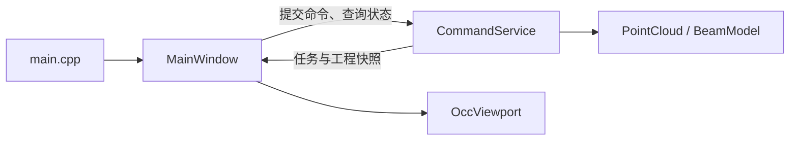

# ReverseModeling 开发指南

本项目是基于 C++20、Qt Widgets 和 OCCT 的点云辅助逆向建模桌面应用。主要流程是：导入 PCD 点云，计算梁框架与尺寸初值，编辑 H 型钢及肋板参数，生成模型，再进行偏差计算和 STEP 导出。

工程包含两个可执行程序：

| 程序 | 职责 | CMake 入口 |
|---|---|---|
| `ReverseModeler` | 桌面交互、点云与模型显示、建模操作 | [主程序 CMakeLists.txt](CMakeLists.txt) |
| `ReverseServiceTests` | 使用 Google Test 检查几何与命令服务 | [测试程序 CMakeLists.txt](../tests/CMakeLists.txt) |

开发时打开仓库根目录的 [CMakeLists.txt](../CMakeLists.txt)。两个程序直接编译同一份业务源码，工程内部不生成独立业务库。

## 目录与代码入口

```text
PointCloudReverseModeling/
├── CMakeLists.txt               # 总入口，加载两个子项目
├── CMakePresets.json            # 全仓库唯一的构建预设
├── cmake/
│   ├── common.cmake             # C++ 标准、编译选项与输出目录
│   └── Dependencies.cmake       # 全部第三方库查找与公共链接库
├── ReverseModeling/
│   ├── CMakeLists.txt           # 主程序文件清单、头文件搜索目录和链接库
│   ├── ReverseModeling.cmake    # 汇总 core、geometry、commands 的公共文件
│   ├── main.cpp                # QApplication 与 MainWindow 入口
│   ├── core/                   # 点云、参数、网格和结果的数据类型
│   ├── geometry/               # 点云读取、PCA、建模、STEP 与偏差算法
│   ├── commands/               # 异步命令、工程状态、参考参数与 JSON
│   ├── workbench/              # Qt 窗口与 OCCT 视口
│   └── examples/               # 参数格式示例
└── tests/
    ├── CMakeLists.txt           # 测试程序文件清单、头文件搜索目录和链接库
    ├── tests.cmake             # 测试文件清单
    └── service_tests.cpp        # Google Test 用例
```

建议按以下顺序阅读：

| 文件 | 重点 |
|---|---|
| [main.cpp](main.cpp) | 应用启动与主窗口创建 |
| [MainWindow.cpp](workbench/MainWindow.cpp) | 用户操作、参数面板、任务轮询和界面刷新 |
| [WorkbenchActions.cpp](workbench/WorkbenchActions.cpp) / [RibbonBuilder.cpp](workbench/RibbonBuilder.cpp) | 共用动作、能力标记、Ribbon 与视图工具条 |
| [DockWorkspace.cpp](workbench/DockWorkspace.cpp) | ADS 工具窗口、窗口菜单、布局保存与恢复 |
| [WorkbenchPanels.cpp](workbench/WorkbenchPanels.cpp) | 参数编辑/应用、参考值恢复和后续操作表单 |
| [WorkbenchTheme.cpp](workbench/WorkbenchTheme.cpp) | 深色主题、自有图标与高 DPI 图标尺寸 |
| [CommandService.h](commands/CommandService.h) / [CommandService.cpp](commands/CommandService.cpp) | 命令入口、任务状态、工程快照和版本控制 |
| [Types.h](core/Types.h) | `CloudData`、`BeamParameters`、`MeshData` 等公共数据契约 |
| [PointCloud.cpp](geometry/PointCloud.cpp) | PCD 读取、单位转换、有效点过滤和 PCA 初值 |
| [BeamModel.cpp](geometry/BeamModel.cpp) | 板件建模、网格生成、STEP 导出与回读、偏差计算 |
| [ParameterDefaults.cpp](commands/ParameterDefaults.cpp) | 可编辑的板厚、肋板位置和截面方向参考值 |
| [OccViewport.cpp](workbench/OccViewport.cpp) | 点云与三角网格的 OCCT 显示适配 |

## 业务调用流程



1. **导入点云**：`MainWindow` 调用 `submitImport()`，后台依次执行 `loadPointCloud()`、`estimateBeam()` 和 `suggestBeamParameters()`，得到点云、梁框架、尺寸初值及参考参数。
2. **生成模型**：参数面板区分编辑草稿与已应用参数；应用时检查基础尺寸和肋板输入。开始重建时提示处理尚未应用的编辑，再将已应用参数和工程版本传给 `submitReconstruct()`，服务调用 `buildBeam()`，成功后提交模型摘要与显示网格。
3. **更新显示**：界面通过定时器轮询 `task()`，读取 `project()` 返回的工程快照，再更新参数、日志和 `OccViewport`。
4. **导出与偏差**：`submitExport()` 执行 STEP 写出及独立回读检查；`submitDeviation()` 计算点到当前模型板件表面的距离。

服务与几何接口见 [CommandService.h](commands/CommandService.h) 和 [Geometry.h](geometry/Geometry.h)。[Json.h](commands/Json.h) 提供任务、工程摘要的序列化和参数解析，当前 `schemaVersion` 为 1，摘要不携带点云或网格大数组。

### 数据与线程约定

- 内部尺寸统一为 **mm**；导入时必须指定原始单位 mm、cm 或 m。`CloudData` 中的点使用局部坐标，项目坐标为 `position + originMm`；`MeshData` 顶点使用项目坐标。
- `CommandService` 同时执行一个后台任务，忙时拒绝新提交。工作线程执行几何计算，QWidget 和 AIS 对象由 GUI 线程操作。
- 重建、导出和偏差命令携带 `expectedRevision`，旧版本请求会被拒绝。导入或重建成功后更新工程版本；失败保留原有结果。
- 取消通过 `std::stop_token` 协作完成。关闭窗口时服务请求取消并等待工作线程结束，单次 OCCT 内核调用可能需要等待其返回。
- 当前工程状态保存在内存，任务与资产 ID 在本次服务生命周期内有效。

## 桌面工作台

`MainWindow` 继承 `SARibbonMainWindow`，使用 `UseRibbonMenuBar | UseNativeFrame` 保留原生系统标题栏。SARibbon 组织顶部功能区，单层 ADS 管理固定中央视图和六类工具窗口。视图容器、日志及工程摘要由 `MainWindow` 装配，视图工具条由 `RibbonBuilder` 创建，重建参数与操作表单集中在 `WorkbenchPanels`；各文件入口见上方代码表。

布局与交互参考 CypModeler 截图及灵控平台 `D:/projectWQZ/ProjectManager/project/LingkongPlatformLauncher/src/LingkongPlatformLauncher/Launcher/MainWindow.cpp`。主要借鉴其 Ribbon 分组、组件尺寸和 OCCT 容器用法；本工程使用独立的主题与单层 Dock 管理，不引入灵控的插件系统、嵌套 QDockWidget 或构建包装。截图只提供 UI 参考，不能据此认定对应算法或文件格式已经实现。

### 工具窗口与布局生命周期

| 窗口 | 稳定 `objectName` | 初始停靠位置 | 当前内容 |
|---|---|---|---|
| 模型树 | `dock.modelTree` | 左侧 | 当前工程、点云及 H 型钢/肋板状态摘要 |
| 属性 | `dock.properties` | 右侧 | 工程版本、来源、有效点数和实体数；对象选择与编辑待接入 |
| 重建参数 | `dock.reconstruction` | 左侧 | 有效 H 型钢/肋板参数及禁用的后续参数区域 |
| 操作面板 | `dock.operation` | 左侧 | 移动、旋转、基准面、孔洞等操作表单 |
| 日志窗口 | `dock.log` | 底部 | 日志、复制所选和清空；隐藏时继续收集 |
| 任务信息 | `dock.tasks` | 底部 | 当前任务名称、状态、阶段和进度，不维护历史任务列表 |

中央三维视图使用 `dock.viewport`，不可关闭、移动或浮动，不列入窗口菜单。辅助窗口默认隐藏，按需打开；同侧窗口可标签化组合，自动隐藏侧边栏暂未启用。窗口菜单直接复用 `CDockWidget::toggleViewAction()`，勾选表示窗口已打开，标签被其他窗口遮挡不代表关闭。

关闭辅助窗口等价于隐藏，不启用 `DockWidgetDeleteOnClose`，重开沿用原实例及内容。Ribbon“重建参数”和窗口菜单指向同一个 Dock，重复打开只显示并激活该窗口。“隐藏所有辅助窗口”保留中央视图、Ribbon 和状态栏；“恢复默认布局”恢复初始停靠安排并收起辅助窗口，不清空点云、模型、日志或参数。

布局在 `QSettings` 的 `ui/layout/v1` 组保存主窗 `geometry` 和 ADS `docks` 状态，ADS 布局版本为 1。启动顺序为：设置 ADS 全局配置 → 创建中央 Dock 并调用 `setCentralWidget()` → 注册全部工具 Dock → 捕获默认布局 → 恢复用户布局。恢复失败回退默认快照，并检查主窗与浮动窗口标题栏是否仍在可用屏幕范围内。正常关闭流程被接受后才保存布局；有后台任务时先请求取消并等待安全退出。窗口集合或保存格式发生不兼容变化时同步升级配置组与布局版本。

### 动作、参数与后续接入

`WorkbenchActions` 统一创建 QAction、稳定名称、快捷键和能力标记，供 Ribbon、菜单及快捷键共用。`MainWindow` 根据项目快照、任务和参数修改状态更新可用性：已有业务正常提交服务；表单预览动作只打开输入界面，执行按钮禁用；尚未接入的命令整体禁用并说明原因。忙时仍可查看日志和切换工具窗口。

| 功能区域 | 已有能力与预留入口 |
|---|---|
| 文件 | 打开 PCD、导出 STEP 使用现有服务；打开文件夹、参数导入/导出及其他导出格式待接入 |
| 编辑与点云 | 撤销、重做、重置、截取/删除点云，以及更多菜单中的对齐、去重、识别精度、AI 去噪/分板均为预留命令 |
| 重建 | 参数、开始重建和停止重建连接现有服务；局部重建待接入 |
| 模型修改 | 选点建模、障碍物、板厚/轮廓调整、槽钢/角钢、贴板/底板、过焊孔/底边孔、圆角/倒角、移动及旋转提供表单；删除模型和钢结构命令待接入 |
| 工具 | 测量、基准面提供表单；计算偏差使用现有服务 |
| 视图工具条 | 点云/实体显隐和适合视图可用；选择及点/线/面/体过滤、渐变着色、线框、剖切与方向立方体待接入 |

“停止重建”仅取消重建任务；其他任务使用状态栏的“取消任务”。新增 UI 命令继续通过 `CommandService` 提交，沿用 `expectedRevision` 和单任务规则；Qt、SARibbon、ADS 类型不进入 `core`、`geometry` 或业务服务契约。

重建参数采用模板入口、滚动内容和固定底部按钮。当前有效模板为 H 型钢/肋板，保留来源点云、PCA 框架、尺寸、板厚、肋板位置、截面方向交换及参考值说明。“应用参数”通过校验后保存有效参数并标记需要重建；存在编辑草稿或参数已应用但未重建时，STEP 导出和偏差计算禁用。直接开始重建会先提示应用尚未提交的编辑。油箱模板及高级识别选项保持禁用，其字段不写入当前 `BeamParameters`。

操作面板共用一个 Dock，在内部切换表单：移动为 X/Y/Z，旋转含轴、角度及中心，基准面提供三点/特征面卡片，孔洞、倒角和测量提供类型及必要数值控件。当前支持编辑、复位、取消和切换，几何执行禁用；关闭仅隐藏，取消或切换操作会清理对应草稿。后续接入采用“确定提交、取消放弃”，不让输入变化直接修改正式模型。

### 原生视口、主题与依赖

`OccViewport` 通过 `ForceNoScrollArea` 放入固定中央 Dock，普通 QWidget 工具条与原生视口上下布局；下拉菜单使用独立弹窗，不在原生绘制区上叠加透明输入层。保留已有 `WinIdChange` 和 resize 处理。参数表单内部可使用 `QScrollArea`，工具 Dock 从内容最小尺寸获取约束；修改布局时关注分隔条、浮动面板及窄窗口下的内容裁切和鼠标坐标，不无差别设置 `WA_NativeWindow`。

主题入口为 [WorkbenchTheme.cpp](workbench/WorkbenchTheme.cpp) 和 [workbench.qss](workbench/resources/workbench.qss)，资源通过 `.qrc` 管理。当前采用深蓝黑背景、青蓝强调色和浅色文字：视口背景 `#081521`、面板背景 `#0B202A`、强调色 `#1EA7D8`、主文字 `#DCE4EA`。图标由 QPainter 绘制多个尺寸及禁用状态，不裁剪参考软件图标，也不额外依赖 QtSvg。主窗口与 ADS 使用统一 QSS，避免库的默认主题覆盖；Ribbon 中文字体、分组标题高度和图标尺寸需协同调整，布局尺寸使用逻辑像素。

[Dependencies.cmake](../cmake/Dependencies.cmake) 统一查找 `SARibbonBar 2.8.0` 和 `qtadvanceddocking-qt6 4.5.0`。[主程序 CMakeLists.txt](CMakeLists.txt) 仅为 `ReverseModeler` 链接 `SARibbonBar::SARibbonBar` 与 `ads::qtadvanceddocking-qt6`，并启用 `AUTOMOC`/`AUTORCC`；两个 UI 库不加入 `RM_COMMON_LIBRARIES` 或服务测试目标。继续通过安装前缀消费匹配的 SDK，不引入第三方源码构建。运行时 DLL、Qt 插件和 OCCT 资源要求见[根 README](../README.md#构建与运行)，正式分发需保留所用库的许可证文件。

## 修改代码与添加文件

头文件与源文件放在同一功能目录，各目录的同名 `.cmake` 分别使用 `RM_SOURCES` 和 `RM_HEARDERS` 汇总文件。**每个文件单独一条追加语句**：

```cmake
list(APPEND RM_SOURCES "${CMAKE_CURRENT_LIST_DIR}/Example.cpp")
list(APPEND RM_HEARDERS "${CMAKE_CURRENT_LIST_DIR}/Example.h")
```

`RM_HEARDERS` 是当前工程约定的变量名称。两个程序的 `CMakeLists.txt` 分别初始化文件清单并创建目标；公共文件由 [ReverseModeling.cmake](ReverseModeling.cmake) 汇总。主程序专用的 `main.cpp`、`workbench` 和测试专用的 `tests.cmake`，分别在对应程序的 `CMakeLists.txt` 中加入。

| 修改内容 | 维护位置 |
|---|---|
| 点云或几何算法 | `geometry/` 及 `geometry.cmake` |
| 命令、任务或工程状态 | `commands/CommandService.*`；公共数据类型放在 `core/Types.h` |
| 默认参数策略 | `commands/ParameterDefaults.cpp` |
| 界面与显示 | `workbench/` 及 `workbench.cmake` |
| 新增公共模块 | 新建同名 `.cmake`，由 `ReverseModeling.cmake` 包含 |
| 新增第三方依赖 | 在 `Dependencies.cmake` 查找；公共链接库加入 `RM_COMMON_LIBRARIES`，程序专用库在对应 `CMakeLists.txt` 链接 |
| 新增测试 | `tests/service_tests.cpp`；新增测试文件时逐个加入 `tests/tests.cmake` |

## 单元测试

测试程序位于独立的 [tests/](../tests/) 目录，直接编译公共服务实现。现有用例覆盖单位、点云属性、参考参数、几何与偏差、取消及异常输入，以及服务版本控制、失败保留和 STEP/JSON 往返。配置、构建与运行方式见 [测试程序说明](../tests/README.md)；工程整体环境与运行说明见 [根 README](../README.md)。

## 当前能力边界

- 桌面 UI 框架及现有业务入口已接入；细粒度对象选择/属性编辑、新几何操作、剖切、线框/渐变着色、方向立方体和油箱模板算法仍待实现。各入口状态见[桌面工作台](#桌面工作台)。布局记忆不保存点云、模型和参数。
- 支持 PCD 的 ASCII、binary、binary_compressed 格式。内存中保留 XYZ、intensity、源点索引、字段名称和无效点计数，其他字段保留在原文件中。
- PCA 提供梁框架和包围尺寸初值；板厚、肋板位置等由参考策略提供，用户可编辑。默认板厚通常为 8/12/8 mm，肋板位于梁长的三分点，小尺寸数据按比例缩小。这些值用于辅助建模，结果需要结合实物核对。
- 当前模型由 H 型钢主板及成对肋板组成。偏差计算针对有限矩形板件表面，包含端面与边界；任意 CAD 模型的通用距离计算尚未实现。
- STEP 导出检查实体有效性，并独立回读核对实体数、体积等结果；目标文件已存在时拒绝覆盖。
- 尚未提供工程持久化、撤销重做、自动轮廓与孔洞恢复、Python 绑定或 Web 服务。

参数格式示例见 [beam-parameters.json](examples/beam-parameters.json)，桌面参数通过界面编辑，当前未提供该 JSON 文件的导入入口。研究背景与后续方案见 [参考资料入口](../reference/README.md)，Python 扩展约定见 [Python 脚本编码规范](../docs/Python脚本编码规范.md)。
